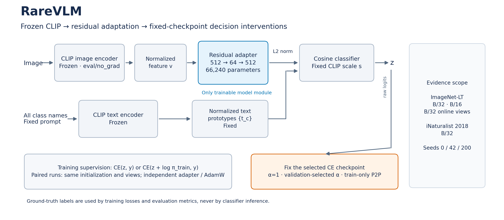
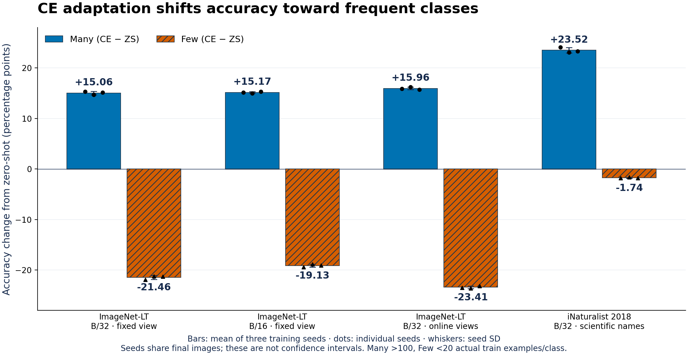
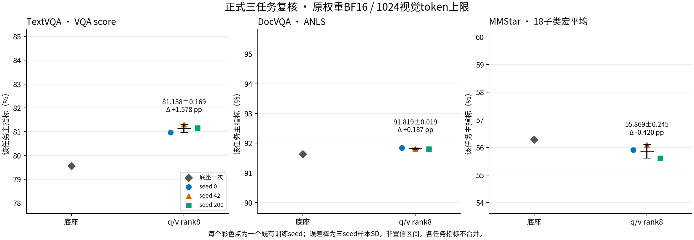
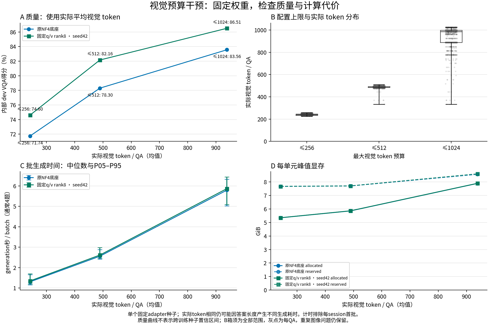
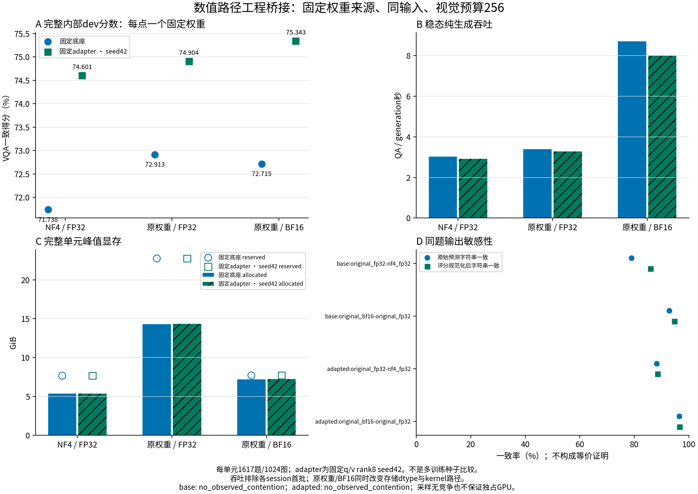

# RareVLM

## 长尾视觉适配、多模态指令微调与图文检索

简体中文 · [English](README.en.md) · [项目架构](docs/ARCHITECTURE.md) · [研究与学习路线](docs/JOB_ROUTE.md)

RareVLM 研究有限可训练参数、视觉信息与计算预算下的视觉语言模型适配。项目包含冻结 CLIP 的长尾分类、校准与图文检索，以及 Qwen2.5-VL 的受控 SFT、生成式评测和推理质量—成本分析。各模块独立验证，不将分类、VQA和检索指标合成总分。

CLIP 主实验与各多模态协议分别归档。2026-10-12归档快照中的Qwen深入研究为 **17 次训练、101 个跨协议评测单元**；后续研究在各协议另列，评测单元不是独立重复样本。项目保留负结果：频次加权未通过罕见答案门槛；区域策略超过双视图对照，但比同预算单整图低 **5.850 个百分点**。



## 已验证的主要结论

1. **普通 CE 存在头尾取舍。** ImageNet-LT B/32 三种子中，Many 相对零样本提高 **15.06 pp**，Few 下降 **21.46 pp**。
2. **固定表征后仍能调整决策。** 验证集选择校准强度后，OA/Few 从 **61.38/37.76%** 变为 **65.36/61.23%**；校准不更新 adapter、编码器或文本原型。
3. **输入信息影响质量和成本。** 固定 SFT checkpoint 的视觉预算上限从256提高到1024，内部dev共识分提高 **11.905 pp**，摊销生成时间约增加 **4.26倍**。
4. **数值工程收益有明确范围。** 固定256预算，原权重FP32→BF16的纯生成吞吐提高 **2.44倍**、峰值allocated下降 **49.66%**；这些是推理结果。
5. **新候选不自动成为成功成果。** 温和频次加权与单区域分配均保留完整对照、失败样本和限制，没有把弱对照收益当成整体最优。

`pp` 表示百分点；跨任务指标、内部dev与公开benchmark、不同输入/数值协议不混合比较。

## 图文检索与推理复核：2026-10-14更新

完整Flickr30k WebDataset实际含29,000张源训练图；固定持出1,000图dev，28,000训练图，每图5caption。冻结FP32 CLIP-B/32表征，训练双侧残差adapter共132,480参数；两负采样策略各3seed、10epoch固定Final@10，正式test为1,000图/5,000caption。

| 完整test，均值±3seed样本SD | 文搜图Recall@1（%） | 图搜文Recall@1（%） |
| --- | ---: | ---: |
| 冻结CLIP（无seed SD） | 58.780 | 77.600 |
| 随机负样本 | 61.640 ± 0.461 | 74.533 ± 0.702 |
| 混合困难负样本 | 59.487 ± 0.647 | 73.633 ± 0.115 |

随机文搜图均值比冻结底座+2.860pp，同时图搜文−3.067pp，不能称双向改善。混合困难相对随机的文搜图差−2.153pp，条件图像簇95%区间[−3.260,−1.060]，三个seed均为负，主门槛失败。Recall采用hit-any正项命中，nDCG另列；预训练重叠未知，公开test已历史曝光。[检索协议](docs/CLIP_RETRIEVAL_V1_PROTOCOL.md) · [完整便携指标](results/clip_retrieval_v1_metrics.json) · [检索训练源码](src/clip_retrieval/train.py)

独立强配置正式复核共23,698条model×QA、0训练：原dense batch4→分段SDPA batch16，TextVQA/DocVQA/MMStar的三轮预处理+H2D+生成阶段吞吐比中位数为2.537/2.385/1.809×，仅DocVQA通过预设质量非劣门槛（ANLS91.843→91.841）。TextVQA/MMStar未通过；相对dense4的allocated增加约1.52–1.70GiB。该固定普通CE seed42 checkpoint与上方历史三seed SFT不是同一组adapter，不能混表或称所有任务无损、线上SLA、省显存。[强配置复核协议](docs/VLM_STRONG_CONFIRM_V1_PROTOCOL.md) · [完整便携指标](results/vlm_strong_confirm_v1_metrics.json)

[多正集合损失对照](docs/CLIP_RETRIEVAL_SET_V1_PROTOCOL.md)已完成六次完整训练和七个完整dev格，只改变图搜文正项聚合，保留文搜图loss及同一负池。原平均正项→集合正项的dev文搜图R1为64.153±.273→62.967±.630%，图搜文R1为78.233±.814→77.467±.513%，图搜文nDCG10为73.714→71.580。文搜图差−1.187pp，探索95%图像簇区间[−1.794,−.580]；图搜文差−.767pp区间[−2.267,.767]跨0。仅1/3seed图搜文为正，预设门槛失败，本轮未追加test。原基线三seed逐query指标与Top10完整复现；两方法初始化/锚点与负池序列/曝光SHA一致。不能仅因目标与hit-any指标接近而认为泛化会改善。[完整便携指标](results/clip_retrieval_set_v1_metrics.json)

配套精读固定OpenCLIP、BLIP、lmms-eval源码，提供真实480项logits/梯度、源图和召回排序。零GPU审计已核对两组各5000条保存TextVQA预测，评分差异超过1e−12的条目为0；这是评分函数对照，不证明完整框架/输入等价。训练监控有并发占用记录，未将训练时间包装成独占性能指标；已有任务未终止，正式简历未修改。

[冻结CLIP教师关系蒸馏](docs/CLIP_RETRIEVAL_DISTILL_V1_PROTOCOL.md)已完成并通过dev/test全部预设门槛：保留原多正目标，加同候选池双向KL、固定lambda1，新增三个完整训练并复用三个原checkpoint与四dev对照格；dev通过后才新评测七个完整test格。

| 完整test，均值±3seed样本SD | 文搜图Recall@1（%） | 图搜文Recall@1（%） | 图搜文nDCG@10（%） |
| --- | ---: | ---: | ---: |
| 冻结CLIP（无seed SD） | 58.780 | 77.600 | 70.087 |
| 原多正平均目标 | 61.640 ± 0.461 | 74.533 ± 0.702 | 71.146 ± 0.085 |
| 原目标＋冻结教师KL | **67.820 ± 0.122** | **79.833 ± 0.404** | **76.705 ± 0.195** |

对原目标，T2I增+6.180pp、探索95%图像区间[5.060,7.320]，I2T增+5.300pp、[3.467,7.133]；三统计端点各单侧alpha=.05/3。I2T对冻结点值+2.233pp的区间[−.067,4.533]跨0，单侧下界−.301高于预设−.5非劣界限，不能称显著超过冻结。三个种子对原目标双向均正，新test原对照逐query/Top10重现v1，匹配初始化/负池序列/曝光SHA；七test格均从Top10独立重评分核验。[完整便携指标](results/clip_retrieval_distill_v1_metrics.json) · [蒸馏损失源码](src/clip_retrieval_distill/loss.py)

该结果支持本协议中的整套训练正则配置；lambda1相当于监督与教师软目标混合，尚无均匀软目标/相似熵对照，不能把增益全部归于教师语义结构。公开test已历史曝光、pretrain重叠未知；不称盲测、长尾问题已解决、模型压缩、VLM/Reranker或工业部署。正式简历与PDF保持，个人贡献/掌握需独立核对。

## CLIP长尾主结果

采用 `{0,42,200}` 三种子均值；零样本为确定性参考。下表均为验证集选择的校准强度，列中为 **OA / Few（%）**。fixed view为固定训练视图，online views为在线裁剪与翻转。

| 数据集与配置 | 零样本 OA / Few | CE OA / Few | LA OA / Few | 固定CE＋验证集校准 OA / Few |
| --- | ---: | ---: | ---: | ---: |
| ImageNet-LT · B/32 · fixed view | 59.42 / 59.22 | 61.38 / 37.76 | 65.97 / 59.01 | 65.36 / 61.23 |
| ImageNet-LT · B/16 · fixed view | 63.99 / 63.35 | 67.20 / 44.23 | 71.04 / 63.73 | 70.83 / 64.57 |
| ImageNet-LT · B/32 · online views | 59.42 / 59.22 | 61.54 / 35.81 | 66.64 / 59.28 | 66.11 / 62.90 |
| iNaturalist 2018 · B/32 · fixed view | 3.48 / 3.32 | 5.05 / 1.57 | 5.69 / 3.70 | 5.35 / 2.48 |

iNaturalist 使用8,142个官方科学名文本原型。在该冻结编码器/分类器协议下，OA仅约 **3.48–6.01%**，绝对识别能力有限。三个种子均选择α=0.25；固定α=1使OA下降1.05pp，校准强度不是通用常数。



[完整结果与边界](docs/RESULTS.md) · [28行汇总](results/main_results.csv) · [76条种子记录](results/seed_results.csv) · [核心adapter/loss](src/methods.py) · [校准代码](src/calibrate.py)

## Qwen多模态研究

### 早期工程子集

早期链路验证了图像互斥的数据准备、QLoRA SFT、回答生成和本地推理。4张V100训练1,843,200个语言LoRA参数，视觉编码器与底座冻结；语言权重NF4量化、FP32计算。1轮覆盖1,024张训练图、128张诊断图，每rank64次更新。

| 相同NF4/FP32路径，256张最终图 | 归一化VQA共识分（%） | 任一参考答案匹配（%） |
| --- | ---: | ---: |
| Pretrained instruct | 68.55 | 70.70 |
| QLoRA SFT, fixed final epoch | 71.52 | 75.39 |

增益 **+2.97 pp**，条件图像bootstrap区间 **[−0.20,6.25]**。该单种子工程子集和简化归一化不证明稳定收益或完整benchmark性能。[工程结果](docs/VLM_SFT_RESULTS.md) · [指标与验证](results/vlm_sft_metrics.json)

### 受控SFT与正式复核

深入研究比较相近参数预算的q/v rank8、q/k/v/o rank4和q/v rank4＋视觉merger。阶段1每策略10k QA、三个种子；按内部dev固定规则选两种策略，阶段2各使用32,985 QA、2,062次更新。原始主线共15次训练、67项评测，未按正式val挑选checkpoint。

| 阶段2，NF4/FP32，视觉上限256 | TextVQA正式val | DocVQA ANLS×100 | MMStar子类宏平均 |
|---|---:|---:|---:|
| 固定NF4底座 | 69.030 | 68.730 | 54.732 |
| q/v rank8，均值±种子SD | 72.166 ± 0.062 | 69.901 ± 0.176 | 54.018 ± 0.314 |
| q/v rank4＋merger，均值±种子SD | 72.389 ± 0.085 | 69.954 ± 0.066 | 54.941 ± 0.577 |

后续原权重BF16/1024正式复核采用底座与3个既有q/v checkpoint，完成 **12格、47,396条预测、0新训练**：

| 原权重BF16，视觉上限1024 | 底座 | SFT三checkpoint，均值±样本SD | 平均变化（pp） |
|---|---:|---:|---:|
| TextVQA，5,000 QA | 79.560 | 81.138 ± 0.169 | +1.578 |
| DocVQA，5,349 QA | 91.631 | 91.819 ± 0.019 | +0.187 |
| MMStar，1,500 QA、18子类宏平均 | 56.289 | 55.869 ± 0.245 | −0.420 |



TextVQA三个固定checkpoint的配对探索区间均高于零；DocVQA/MMStar区间跨零，不能证明等价或能力保持成功。实际监督target的rare/mid切片点值未改善，且该正式分析没有切片图像区间。训练来源包含V100/A100，公开val已有历史曝光，预训练重叠未知。

[深入SFT协议](docs/VLM_DEEP_V2_PROTOCOL.md) · [正式复核协议](docs/VLM_FORMAL_BF16_V1_PROTOCOL.md) · [正式便携指标](results/vlm_formal_bf16_v1_metrics.json)

### 视觉预算与数值路径

下表为相同stage2 q/v seed42 checkpoint的内部dev，每格1,617 QA/1,024图；与正式val分开。

| NF4/FP32视觉上限 | 底座共识分 | SFT共识分 | SFT纯生成QA/s |
|---|---:|---:|---:|
| 256 | 71.738 | 74.601 | 2.919 |
| 512 | 78.299 | 82.158 | 1.511 |
| 1024 | 83.562 | 86.506 | 0.686 |

1024−256的SFT增益为 **11.905pp [10.085,13.770]**，生成时间约4.26倍。实际平均视觉token分别为241.607/489.021/938.856，上限不是实际token数；底座也受益，不能归因于LoRA特有机制。



| 固定256预算、同一SFT checkpoint | 共识分 | 纯生成QA/s | 预处理＋H2D＋生成QA/s | allocated GiB |
|---|---:|---:|---:|---:|
| NF4/FP32 | 74.601 | 2.918 | 2.692 | 5.346 |
| 原权重FP32 | 74.904 | 3.285 | 2.996 | 14.317 |
| 原权重BF16 | 75.343 | 8.015 | 6.510 | 7.207 |

原权重FP32→BF16：纯生成2.44倍、三阶段吞吐2.17倍、allocated下降49.66%。分差+0.439pp，区间[−0.091,0.957]，未证明精度等价。统计排除模型加载、预检、写文件和队列开销；不能当成BF16训练或线上服务加速。



独立联合诊断的BF16/1024 SFT结果为86.926、纯生成2.172QA/s、allocated8.652GiB；2.44倍仍属于固定256的FP32/BF16比较。[推理结果及代码](docs/VLM_OPTIMIZATION_RESULTS.md) · [机器可读指标](results/vlm_optimization_v1_metrics.json)

### 频次加权与区域分配：保留负结果

新普通CE与频次加权均使用同初始化、QA顺序、32,985 QA/2,062更新和1,843,200参数。统一BF16/1024内部dev，整体 **87.112→86.877**，rare **87.398→87.281**。预设rare至少+0.5pp的门槛未通过，没有自动扩增种子或正式评测。[加权结果](docs/VLM_WEIGHTED_SFT_RESULTS.md)

区域实验固定普通CE seed42最终adapter，不新增训练；四组共 **6,468条预测**，每题实际 **1,024个合并后视觉token**。CPU检测器只给文字框与置信度，不向VLM提供OCR识别文字或参考答案。图像等比例缩放、灰边填充；随机对照保持选区宽高与面积。

| 新letterbox协议，内部dev1,617 QA | 整体共识分（%） | rare共识分（%） |
|---|---:|---:|
| 单整图，1024 tokens | **84.886** | **82.310** |
| 双整图，512＋512 | 77.372 | 76.491 |
| 全图＋预测文字区域，512＋512 | 79.035 | 78.450 |
| 全图＋随机同形区域，512＋512 | 76.964 | 76.491 |

文字区域相对随机 **+2.072pp [0.752,3.368]**，相对双整图 **+1.664 [0.339,3.020]**，相对单整图 **−5.850 [−7.589,−4.133]**。`gate=true`只表示超过两个双视图控制，并非最优质量。rare相对弱对照的区间跨零，不能宣称长尾改善。

四组allocated均约8.420GiB，缓存VLM阶段吞吐1.74–1.79QA/s；1,024图检测额外554.52秒。等视觉token不等于等信息、总输入、FLOPs或端到端成本。旧native-resize分数不作为同协议基线。[区域结果](docs/VLM_REGION_TOKEN_RESULTS.md) · [区域指标](results/vlm_region_token_v1_metrics.json)

## 安装与本地验证

Python 3.10/3.11，在仓库根目录执行：

```bash
python -m venv .venv
source .venv/bin/activate
pip install -r requirements/base.txt
pip install -e . --no-deps
python -m smoke
```

smoke使用合成数据，不下载图像或模型；检查CE/LA训练、验证选点、checkpoint、固定原型与固定checkpoint校准，输出不作为研究证据。CPU版PyTorch可先从[官方CPU wheel源](https://download.pytorch.org/whl/cpu)安装。

```bash
pip install -r requirements/dev.txt
python -m pytest -q
python tools/check_release.py
```

当前本地验证覆盖 **45项CPU契约**，包含assistant mask、数据隔离、评分、参数预算，以及双rank Gloo相对集中式目标的加权梯度核对。项目使用本地测试、CPU smoke和发布校验，不使用GitHub CI。

GPU研究另装 `requirements/vlm.txt`，按具体协议准备权重、数据、adapter、兼容数值环境和运行路径。原机配置是执行快照，克隆仓库并不自动获得全部实验资产。新任务先检查GPU占用，保留已有进程；本次结构整理不重跑GPU实验。

## 目录与运行入口

```text
RareVLM/
├── src/             CLIP实现与九个vlm_*研究模块
├── tools/           分析、图解学习页、导出与发布检查
├── tests/           CPU契约测试
├── configs/         原实验配置快照
├── requirements/    基础、开发与GPU依赖
├── results/         分协议指标、CSV和历史研究锁
├── assets/          实验图与图片来源记录
├── docs/            协议、结果、复现与学习路线
├── metadata/        源码来源、结构迁移映射和发布清单
├── pyproject.toml   包安装、模块发现与pytest配置
├── README.md        中文首页
├── README.en.md     英文首页
├── CITATION.cff
└── .gitignore
```

保留原有import和模块名：`import methods`、`python -m run_imagenet_lt`、`python -m vlm_region.pipeline`。源码集中在src，配置与输出以项目根为基准。研究过程按[学习路线](docs/JOB_ROUTE.md)连接基本原理、源码、真实图像与保存预测。

目录迁移没有重写旧配置、CSV/JSON结果或研究锁。`metadata/ARCHITECTURE_MIGRATION.json`记录旧/新路径与前后SHA；历史实验绑定提交`2049c0e`。源码改动会触发旧运行锁不匹配，精确历史恢复使用该提交的独立checkout，新运行创建独立输出与来源锁。[迁移说明](docs/ARCHITECTURE.md)

## 证据、边界与引用

- [实验指标](results/main_results.csv)、[种子记录](results/seed_results.csv)、[实验来源](results/provenance.json)与各协议JSON分别保存。
- [图片来源](assets/figure_provenance.json)、[源码来源](metadata/SOURCE_ORIGINS.json)、[历史代码锁](results/research_code_lock.json)、[迁移映射](metadata/ARCHITECTURE_MIGRATION.json)、[发布清单](metadata/PACKAGE_MANIFEST.json)支持复核。
- [深层错误分析](docs/ANALYSIS.md)记录错误转换、先验、margin、表征变化及因果结论限制。
- 单checkpoint图像簇bootstrap区间与三种子SD不同；探索区间没有多重比较校正。未见监督答案不代表预训练未见，也不等同视觉类别长尾。
- 模型、数据集、checkpoint、原始预测和包含原图的离线学习页留在本地；仓库发布源码、聚合指标、图表及学习页生成器。

项目受到TS-MOF/AES/GALE相关研究问题启发；这些科研材料不是本仓库已实现算法的自动归属。主矩阵比较CE/LA与既有校准，未声称新算法或SOTA。第三方代码保留来源和许可证信息。

## 最新机制对照：教师负样本关系

2026-10-14完成[概率置乱对照](docs/CLIP_RETRIEVAL_SHUFFLE_V1_RESULTS.md)：新增三个完整28k图/10epoch训练、三个完整内部dev评分格；六个历史checkpoint与七dev格只读复用。保留正项教师概率、负项概率集合、教师/混合目标熵与损失系数，只置乱负候选对应。原蒸馏减置乱的文搜图R@1为+0.800pp（条件95%图像区间[0.227,1.393]），图搜文+0.267pp（[−0.733,1.300]跨0）。两方向联合门槛未过，不新增test；不能把全部蒸馏收益归因负项语义关系，也不证明两目标等价。原完整test提升保留，正式简历未改。[协议](docs/CLIP_RETRIEVAL_SHUFFLE_V1_PROTOCOL.md)、[便携指标](results/clip_retrieval_shuffle_v1_metrics.json)、[损失实现](src/clip_retrieval_shuffle/loss.py)。后续图文重排另立协议，尚未启动。

下一步候选、JD来源和质量/延迟验收设计见[JD驱动的图文重排计划](docs/NEXT_ACTIONS_20261014.md)，当前尚未执行。

软件引用见[CITATION.cff](CITATION.cff)。仓库许可证发布仍待维护者确认；第三方数据与权重按其来源分别获取。
