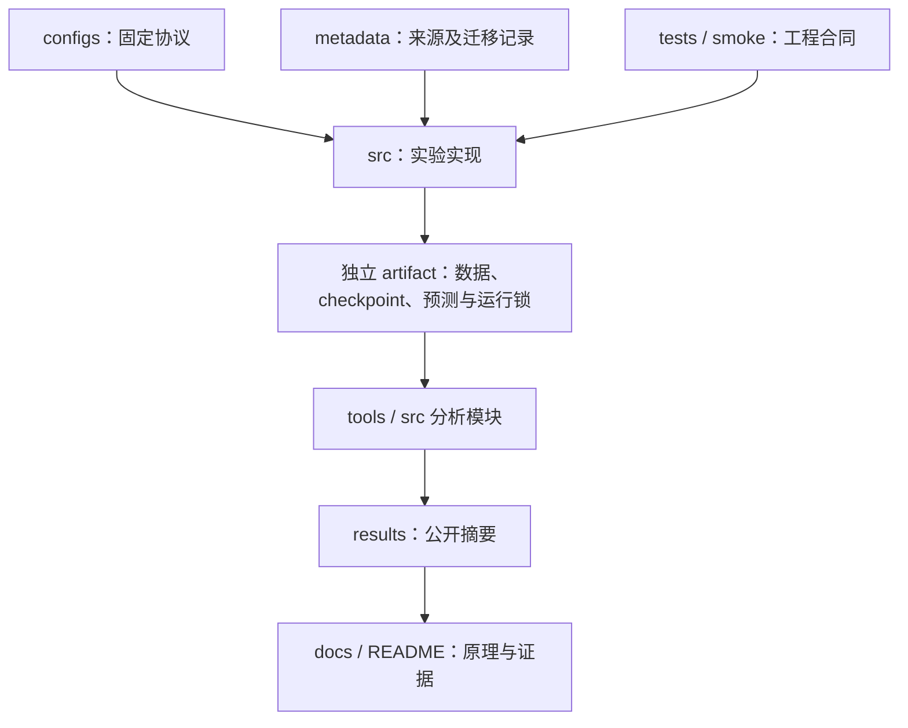

# 项目架构与目录迁移

RareVLM 的源码集中到 `src/`，根目录只保留安装、配置、文档、结果和工程入口。本次整理不引入新算法、不重跑实验，也不改动历史结果或个人简历。

## 目录职责

| 路径 | 内容与用途 |
|---|---|
| [`src/`](../src/) | CLIP 长尾分类、校准与数据入口，以及九个 `vlm_*` 研究模块；保留原 Python 模块名 |
| [`configs/`](../configs/) | 各阶段独立的实验配置，历史协议配置保持原样 |
| [`results/`](../results/) | 可公开复核的精简指标、验证摘要和环境记录；不是完整预测或 checkpoint |
| [`docs/`](./) | 原理、协议、结果、复现步骤和结论边界 |
| [`tools/`](../tools/) | 发布检查、分析及学习页生成工具 |
| [`tests/`](../tests/) | CPU 合同与工程检查，不把 synthetic smoke 当作研究结果 |
| [`requirements/`](../requirements/) | `base.txt` 为 CLIP 基础依赖，`dev.txt` 为验证工具，`vlm.txt` 为可选 VLM 环境依赖 |
| [`metadata/`](../metadata/) | 来源、发布清单与本次路径/源码 SHA256 迁移记录 |
| [`assets/`](../assets/) | 仓库中的轻量展示资源 |
| [pyproject.toml](../pyproject.toml) | 本地测试配置；验证使用 pytest、CPU smoke 和发布检查 |
| [`pyproject.toml`](../pyproject.toml) | 将 `src/` 安装为可导入的项目；不强制安装实验环境依赖 |
| [`README.md`](../README.md)、[`CITATION.cff`](../CITATION.cff) | 中文项目入口与引用信息 |

数据集图片、底座/适配器权重、完整训练状态、原始预测及学习页中的原图保存在各自外部 artifact 目录，未纳入 Git。凭据和本地环境也不属于发布内容。

## 模块关系



CLIP 的 `methods`、`calibrate` 和 `run_imagenet_lt` 等模块仍保持原名称，分别负责模型、固定 checkpoint 校准和训练入口。VLM 使用独立模块记录研究阶段：

| 模块 | 作用 |
|---|---|
| [`vlm_sft`](../src/vlm_sft/) | 初始 QLoRA SFT、生成与计分工程 pilot |
| [`vlm_deep`](../src/vlm_deep/) | 三策略、三种子及跨任务受控研究 |
| [`vlm_a100`](../src/vlm_a100/) | 保留科学协议的两卡 A100 运行适配 |
| [`vlm_probe`](../src/vlm_probe/) | 固定权重下的视觉预算诊断 |
| [`vlm_precision`](../src/vlm_precision/) | 同预算下的量化/精度工程路径对照 |
| [`vlm_joint`](../src/vlm_joint/) | 原权重 BF16 与视觉预算的联合诊断 |
| [`vlm_formal`](../src/vlm_formal/) | 冻结 BF16/1024 协议的正式三任务复核 |
| [`vlm_weighted`](../src/vlm_weighted/) | 监督答案频次加权、DDP 合同与负结果归档 |
| [`vlm_region`](../src/vlm_region/) | 等实际视觉 token 的整图、区域与随机对照 |

各模块保留独立配置与输出目录。共享处理或评分代码的复用不代表不同协议的指标、硬件耗时和选择规则可以混合比较。

## 安装与运行

在仓库根目录使用与目标实验兼容的 Python 环境。依赖文件不自动覆盖已经锁定的历史 GPU 环境：

```bash
# 新建的 CLIP 环境
python -m pip install -r requirements/base.txt
python -m pip install -e . --no-deps

# CPU 工程执行检查；只使用合成数据
python -m smoke

# 查看 CLIP 命令行入口
python -m run_imagenet_lt --help
```

VLM 使用可选依赖文件 [`requirements/vlm.txt`](../requirements/vlm.txt)，并在该环境中执行 `python -m pip install -e . --no-deps`。安装后仍使用 `python -m vlm_region.pipeline` 等原模块命令；运行真实实验之前，先完成对应协议要求的数据、模型、输入与资源准入检查。完整数据入口见[复现步骤](REPRODUCE.md)，VLM 的具体边界见各阶段协议。

## 历史来源锁与恢复

迁移前的完整公开基线是提交 [`2049c0e`](https://github.com/0heng3/RareVLM/commit/2049c0ebc2df6a56531e18c2bdbd7d4355b16b3d)。历史配置、结果和归档中的来源锁保留原字节，不为适配新目录而改写旧 SHA256。

目录变化及必要的入口路径修正会改变当前代码的位置，部分文件的 SHA256 也会变化。[迁移清单](../metadata/ARCHITECTURE_MIGRATION.json)记录旧路径、新路径及迁移前后哈希；[来源记录](../metadata/SOURCE_ORIGINS.json)和[发布清单](../metadata/PACKAGE_MANIFEST.json)位于 `metadata/`。迁移记录说明变化范围，不能替代旧运行锁或证明浮点计算逐位相同。

- 精确恢复旧运行时，在**独立 checkout**中使用上述旧提交和原环境、数据及权重。保留当前工作目录和已有任务，不在正在使用的目录回退提交。
- 当前版本启动新运行时，使用新的输出目录，生成与当前源码、配置、输入和权重匹配的来源锁。
- checkpoint 或预测缓存恢复仍须通过对应模块的严格校验。旧锁与当前源码不匹配时拒绝混用，不删除校验或修改旧锁来绕过检查。

部分历史协议保留了 `/opt/data/private/.tools/vlm-a100-env.sh`、原机路径和旧启动命令，作为已经执行过的环境快照；这些记录不是 clean clone 的便携安装指令。
