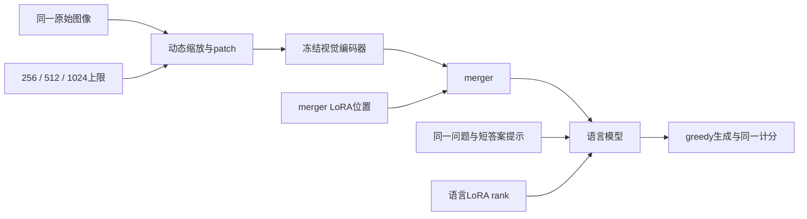

# 完整实验之后：底座选择、岗位能力与下一轮算法研究

更新：2026-10-11，北京时间。面向已有 Python/PyTorch 训练经验、希望结合代码与真实实验边做边学的研究者。

**研究主线保留 Qwen2.5-VL-3B，借鉴开源工程，容量与跨底座复现另立协议。** 本页保留2026-10-11的底座分析及当时行动设计；视觉预算、BF16桥接、联合诊断和正式复核随后均已完成。频次加权未通过rare推进门槛；区域分配超过双视图控制，但仍低于单整图，当前先复用失败样本诊断。最新完成状态及正负结果见[公开研究路线](JOB_ROUTE.md)、[加权结果](VLM_WEIGHTED_SFT_RESULTS.md)和[区域结果](VLM_REGION_TOKEN_RESULTS.md)。

[优化结果、岗位判断与下一步](VLM_OPTIMIZATION_RESULTS.md)与[便携指标](../results/vlm_optimization_v1_metrics.json)记录视觉/数值研究。已有可展示的SFT/评测/工程证据，仍缺等成本算法贡献和生产系统验证；项目完成记录不代表个人熟练程度或独立贡献。

以下保留视觉预算及BF16矩阵完成前的A+B分析、2026-10-11官方仓库核查与初始行动设计；其中“当前/待执行/尚未验证”描述属于对应历史阶段，新完成结果以研究路线及各结果文档为准。本次公开整理未重新检索上游模型或JD。冻结训练/评测源码与原协议继续保留。

## 1. 已完成实验究竟说明什么

数据依据为 [公开主实验指标](../results/vlm_deep_v2_metrics.json)、三种子汇总表（本地归档，未发布）：`rarevlm_pilot/outputs/vlm_deep_v2/final_analysis/core_task_summary.csv`和逐 checkpoint 同图配对表（本地归档，未发布）：`rarevlm_pilot/outputs/vlm_deep_v2/final_analysis/paired_image_cluster_contrasts.csv`。A+B 于 **2026-10-11 11:03:35** 完成，核验通过 **15 次训练、67 项评测、233,839 条保存预测重计分**。核验结果表明运行记录与结果可复核，不等同于方法新颖性或因果机制已经成立。

以下是全量训练 stage2 的三种子均值 ± 样本标准差，所有值按百分数表示。TextVQA 是共识分；DocVQA 是 ANLS；MMStar 使用冻结协议的子类别宏平均，因此三列不可直接求平均来宣布“整体能力”。

| 条件 | TextVQA | DocVQA | MMStar |
| --- | ---: | ---: | ---: |
| 同数值路径 NF4 底座 | 69.030 | 68.730 | 54.732 |
| q/v rank8 | 72.166 ± 0.062 | 69.901 ± 0.176 | 54.018 ± 0.314 |
| q/v rank4＋merger | 72.389 ± 0.085 | 69.954 ± 0.066 | 54.941 ± 0.577 |

图表（本地归档，未发布）：`rarevlm_pilot/outputs/vlm_deep_v2/final_analysis/full_results.png`

**读图方法：**先在同一任务内比较底座、10k 与全量训练，再比较三种子的离散程度；原完整图在本地归档，公开数值见上表与轻量指标。目标任务收益不能直接推出跨任务收益。图中的 SD 描述训练种子变化，不是同图配对区间。

与同路径 NF4 底座相比，两个全量策略的 TextVQA 均值分别提高 **3.136、3.359 个百分点**，DocVQA 均值分别提高 **1.171、1.224 个百分点**。因此当前底座还可以从下游适配获益，尚未出现“换底座是唯一有效行动”的证据。MMStar 上 q/v 均值低于底座约 **0.713 个百分点**，merger 策略高于底座约 **0.209 个百分点**；应继续观察能力保持，不能据此宣布普遍遗忘或已解决遗忘。

merger 策略在 TextVQA 上比 q/v rank8 高 **0.223 个百分点**，但每个种子的同图配对 95% 区间均包含 0：

| seed | merger − q/v，百分点 | 图像聚类 bootstrap 95% 区间 | 训练硬件 |
| --- | ---: | --- | --- |
| 0 | +0.056 | [−0.367, +0.493] | q/v 为 V100，merger 为 A100 |
| 42 | +0.324 | [−0.121, +0.746] | 两者均为 A100 |
| 200 | +0.290 | [−0.166, +0.747] | 两者均为 A100 |

这些区间使用 2,000 次图像聚类重采样，同图的全部问题一起抽样。它们**条件于对应的一对已训练 checkpoint**，不包含重新训练造成的不确定性；三个 seed 没有合并为伪独立题目。分析是事后探索，未进行多重比较校正。区间跨 0 不证明两方法等价，而是当前比较不足以宣称稳定优势。

DocVQA 的两策略均值差仅 **0.054 个百分点**，逐种子配对方向有正有负。MMStar 的策略差值为 **+1.597、+1.088、+0.082 个百分点**，波动较大；seed0 还存在训练硬件不同的因素。对照和区间均保留在上述 JSON/CSV 中。

图表（本地归档，未发布）：`rarevlm_pilot/outputs/vlm_deep_v2/final_analysis/data_expansion_deltas.png`

**读图方法：**q/v 的 TextVQA 从 10k 到全量提高约 **0.716 个百分点**，merger 策略提高约 **0.640 个百分点**。但每轮数据从 10,000 增至 32,985 条 QA，同时更新数从 625 增至 2,062；部分训练还迁移了硬件。这是“数据＋更新次数＋部分硬件变化”的联合比较，不能独立归因为数据质量或数量。

数值路径也是研究条件。已完成的 A 矩阵保持 FP32 计算与 FP32 视觉，比较原始权重和仅语言线性层 NF4 权重；以下四格均为完整 TextVQA 官方 val 实测，数字对应各次历史评测，公开链接指向包含数值路径矩阵的轻量指标：

| adapter 状态 | 原始权重＋FP32 | 语言 NF4＋FP32 | NF4 − 原始，百分点 |
| --- | ---: | ---: | ---: |
| 无 adapter | [70.328%](../results/vlm_deep_v2_metrics.json) | [69.030%](../results/vlm_deep_v2_metrics.json) | −1.298 |
| 同一个历史 pilot adapter | [71.112%](../results/vlm_deep_v2_metrics.json) | [70.382%](../results/vlm_deep_v2_metrics.json) | −0.730 |

观察到的推理权重路径差 **1.298／0.730 个百分点**，大于全量 merger 与 q/v 策略之间的均值小差 **0.223 个百分点**。它提示数值与权重路径值得优先研究，但这些比较使用不同 adapter 状态与 checkpoint，不能直接比较效应显著性，也不能把差值当作 merger 的机制解释。历史 pilot adapter 在 NF4 下训练，因此推理 2×2 矩阵不能解释为训练量化的完整因果分解。主实验收益仍使用同路径 NF4 底座作为参照。[冻结协议](VLM_DEEP_V2_PROTOCOL.md)

两卡 A100 每卡 80GB 给新研究提供了评估未量化底座与 BF16 路径的显存空间。**视觉预算探针之后，优先建立独立的原始权重／BF16 数值工程桥接协议，比直接追逐更大底座或继续放大小幅 LoRA 位置差异更有依据。**先固定模型、数据、视觉预算和生成规则，验证质量、实际 token、稳态吞吐、显存与完整恢复；推理桥接与重新训练分别记录。目前没有 BF16 结果，不能声称它已恢复上述分差或已经加速。

当前运行中的六格视觉预算探针继续使用冻结的 **语言 NF4＋FP32**，只改变视觉预算。待该探针完成后另开数值路径目录与协议；新 BF16／原始权重结果不与旧 NF4/FP32 三种子结果混列，不在已经运行的探针中途切换权重或精度。

## 2. 从代码理解：LoRA 的容量与插入位置是两件事

对一个输入维度为 `d_in`、输出维度为 `d_out` 的线性层，LoRA 使用：

\[
W_{\mathrm{eff}}=W_0+\frac{\alpha}{r}BA,\qquad
A\in\mathbb{R}^{r\times d_{\mathrm{in}}},\quad
B\in\mathbb{R}^{d_{\mathrm{out}}\times r}.
\]

新增参数数目为 `r × (d_in + d_out)`。rank `r` 限制的是这一层增量矩阵的秩上界；它不是整个模型的“知识数量”。[LoRA 原论文](https://arxiv.org/abs/2106.09685)

在当前 3B 的语言层中，q 投影为 2048→2048，v 投影为 2048→256；rank8 的 q/v 每层分别有 32,768 与 18,432 个参数，合计 51,200，36 层得到 **1,843,200**。v 输出较小是模型结构特征，不能假设 q/k/v/o 的尺寸都相同。可展开实际 checkpoint 张量的图解课堂（本地归档，未发布）：`rarevlm_pilot/outputs/vlm_learning_v1/图解课堂.html`核对形状。

| 已执行策略 | 可训练语言参数 | 可训练 merger 参数 | 总参数 | 能回答的问题 |
| --- | ---: | ---: | ---: | --- |
| q/v rank8 | 1,843,200 | 0 | 1,843,200 | 集中于两种语言投影的较高 rank |
| q/k/v/o rank4 | 1,843,200 | 0 | 1,843,200 | 相同参数预算覆盖更多语言投影 |
| q/v rank4＋merger rank64/36 | 921,600 | 913,408 | 1,835,008 | 将约一半预算从语言投影分配给视觉—语言连接模块 |

三者定义在 [vlm_deep_v2.json](../configs/vlm_deep_v2.json)，目标模块选择与实际计数在 [model.py](../src/vlm_deep/model.py)。代码先冻结底座，再枚举 36 层语言投影和明确的 `visual.merger.mlp.0/2`，设置独立 rank/alpha，并要求实际可训练参数等于配置值；`parameter_groups()` 分别统计语言与 merger。

```python
language = [name for name, module in model.named_modules()
            if '.layers.' in name and 'visual' not in name
            and name.endswith(tuple(spec['projections']))]
merger = ['visual.merger.' + name for name in spec.get('merger_ranks', {})]
targets = language + merger
```

这个选择逻辑很重要：q/k 改变注意力匹配使用的查询和键，v/o 改变值的变换与输出组合；merger 把视觉特征映射到语言模型能够接收的表示。**merger LoRA 更新不等于视觉编码器主干更新。**源码明确禁止视觉 trunk 成为可训练参数，视觉 trunk 保持 eval，含 merger 的策略只把 merger 切换为 train。

q/v rank8 与 q/k/v/o rank4 同时改变 rank 和插入范围，回答的是“同预算如何分配”，不能拆成单独的 rank 因果结论。merger 策略与 q/v rank8 的预算差约 **0.44%**，同时改变语言 rank 和插入位置，因此现有 +0.223 pp 不能直接命名为“merger 的增益”。如果视觉探针支持继续追查连接模块，下一轮可加 **q/v rank4-only**，与 q/v rank4＋merger 保持语言 rank、alpha、数据、更新和 seed 一致；这将检验加入 merger 的条件效应，但总参数预算会增加，必须如实报告。

## 3. 从代码理解：SFT 学什么，loss 怎样给每道题权重

当前监督仅覆盖助手回答与结束 token。图像、问题和提示的 label 为 `-100`，不直接作为预测目标，但依然是生成回答的条件。实际编码在 [common.py 的 encode()](../src/vlm_deep/common.py)，监督区间由 [vlm_sft/common.py 的 answer_labels()](../src/vlm_sft/common.py)构造。

对第 `i` 道问题，有效答案 token 数为 `T_i`，当前目标为：

\[
\mathcal{L}=\frac{1}{N}\sum_{i=1}^{N}\left[
\frac{1}{T_i}\sum_{t\in\mathrm{answer}_i}
-\log p_\theta(y_{it}\mid\mathrm{image}_i,\mathrm{question}_i,y_{i,<t})
\right].
\]

[answer_loss()](../src/vlm_deep/common.py)先计算未归约的交叉熵，再逐题除以有效 token 数：

```python
values = F.cross_entropy(..., ignore_index=-100, reduction='none')
return values.sum(dim=1) / counts, values.sum(), int(counts.sum())
```

随后 [train.py](../src/vlm_deep/train.py)按真实问题数聚合，并处理 DDP 归约与最后不足 batch 的样本权重。有效 batch 是 16；迁移至两卡后为每卡 microbatch8，而非改变学习率或样本曝光。

这与“把整个 batch 的所有答案 token 放在一起平均”有区别：长答案在后者中获得更大的题目权重。更换训练框架时，即使仍然写 `cross_entropy` 和 `assistant_only_loss`，也必须核对 mask、结束 token、逐题/逐 token 权重和最后 batch；否则比较同时更换了训练目标。TRL 提供 assistant-only 与 completion-only 功能，但其行为取决于数据格式和聊天模板 mask，必须按固定版本验收。[TRL SFT 文档](https://huggingface.co/docs/trl/sft_trainer)

## 4. 为什么先做视觉预算，而不是立刻换底座

当前训练与生成处理器设置为 `min_pixels=64×28²`、`max_pixels=256×28²`，即最大约 256 个语言侧视觉 token。Qwen2.5-VL 对图像动态缩放，patch 为 14，空间上 2×2 merge；对于一张处理后尺寸为 `H'×W'` 的静态图，语言侧视觉 token 约为 `H'W'/28²`。最大预算是上限，不保证每张图恰好使用那么多 token；应从 `image_grid_thw` 及实际编码核对。[3B 官方模型卡](https://huggingface.co/Qwen/Qwen2.5-VL-3B-Instruct)

增加视觉 token 的直接意义是保留更多空间细节，可能使小字和相邻文字行更容易区分；也可能无益，甚至受输入分布变化影响。它与 LoRA rank 完全不同：视觉 token 改变输入信息与计算，rank 改变可学习更新的容量。冻结 checkpoint 的输入干预可以先回答“错误对更细图像信息是否敏感”，不需要先完成新训练。



需要区分计算复杂度与整机耗时。对于长度为 `S=L_text+V` 的 decoder prefill，密集注意力中查询—键等部分通常有 `O(S²)` 的计算项；固定其他条件时，视觉 token 增加会提高这一部分的成本。**不能说视觉 token 翻倍后总训练/生成耗时一定变为四倍。**前馈层、投影、Qwen2.5 的视觉窗口注意力、图像解码/resize、量化算子和通讯具有不同成本；使用 KV cache 的逐 token 解码也不同于整段 prefill，FlashAttention 还会改变中间矩阵的存储方式。[Qwen2.5-VL 技术报告](https://arxiv.org/abs/2502.13923)

下一轮最小矩阵已确定，具体定义见 [VLM_BUDGET_PROBE_V1_PROTOCOL.md](VLM_BUDGET_PROBE_V1_PROTOCOL.md)、[配置](../configs/vlm_budget_probe_v1.json)与[执行代码](../src/vlm_probe/evaluate.py)：

| 固定模型状态 | 256 视觉 token 上限 | 512 上限 | 1024 上限 |
| --- | --- | --- | --- |
| 同 NF4/FP32 底座，无 adapter | dev 生成 | dev 生成 | dev 生成 |
| stage2 q/v rank8，seed42 checkpoint | dev 生成 | dev 生成 | dev 生成 |

保留内部 dev、同题同图、同提示、同 greedy 与输出预算，实际 token 数、图像处理结果、逐题预测、分数、吞吐、显存分别保存。三个像素上限为 200,704、401,408、802,816；不将官方 val 分数用于挑选新设置。1024 预算的序列长度需要单独核验，不能套用原训练的 768 token 上限。此轮不更新权重，结果只能说明固定 checkpoint 的输入敏感性，不能直接说明更高分辨率训练的收益。

可检验的解释与后续决策：

| 探针观察 | 支持的下一步 | 不能直接推出 |
| --- | --- | --- |
| 两种状态提高预算后都改善，收益集中于小字/字符串 | 在 dev 中进一步做全图＋预测区域与随机区域对照，控制总视觉预算 | 已证明模型只缺分辨率，或必须训练 OCR |
| 底座改善而 adapter 不改善 | 检查训练分辨率分布与适配后的输入敏感性，再设计高预算训练对照 | 已证明 adapter 破坏视觉表示 |
| 预算改变仍不改善 | 检查题目歧义、目标噪声、图文对应、格式错误，再做容量敏感性基线 | 已证明 3B 容量不足 |
| 两种策略差异仍很小 | 优先错误驱动的数据/输入研究，避免继续堆 LoRA rank | 位置没有任何作用 |

此前 10k 训练答案频次切片只适用于那一训练来源。全量研究必须按 `train_all` 重新统计频次；未见下游答案不代表预训练未见，也不是 CIFAR/ImageNet 的闭集类别长尾。长度、数字形式、问题类型、视觉难度和标注歧义是可能混杂，切片差距不能替代受控实验。

## 5. 分开决定：深化 3B、增加 7B、迁移新代底座、接入工程框架

| 方案 | 研究收益 | 代价与可解释边界 | 目前判断 |
| --- | --- | --- | --- |
| 保留当前 3B 深化 | 接续已冻结的三 seed、数据与误差记录；可检验视觉信息、数据选择、能力保持 | 单模型结论需要外部复现；已有官方 val 曝光需披露 | 当前主线 |
| 同系列 Qwen2.5-VL-7B | 检查模型规模变化下的残留错误与方法收益 | 预训练权重与维度同时变化，不是纯参数数量实验；同 rank 不等于同 LoRA 参数量 | 有诊断动机后增加 |
| Qwen3-VL-4B | 在架构变化相对较少的后继 VLM 上检验迁移 | DeepStack、位置编码、patch/processor 与预训练同时改变，旧 merger 目标不能机械复用 | 旧代复现备选，不称最新 |
| Qwen3.5-4B，必要时 2B/9B | 在较新的原生多模态、混合注意力底座上检验方法是否仍有价值 | 视觉—语言联合预训练、混合 decoder、词表、后训练与推理模式均改变；需要独立环境和协议 | 较新的小型外部验证优先候选，尚未实测 |
| 接入 ms-swift / LLaMA-Factory / TRL | 增加数据接口、训练配置、偏好工具和服务工程 | 默认参数、mask、loss、量化和 checkpoint 格式可能改变科学条件 | 按模块接入，先验收 |

官方 Qwen3-VL 使用 DeepStack 融合多层 ViT 特征，并引入 Interleaved-MRoPE；官方工具明确区分 Qwen2.5 的 `image_patch_size=14` 和 Qwen3 的 16。若先使用 `qwen-vl-utils` resize，需要避免处理器再次 resize。相同像素上限不等于相同视觉 token；跨底座既要报告像素与 token，也要说明处理器差异。[Qwen 官方仓库](https://github.com/QwenLM/Qwen3-VL)

### 2026-10-11 补充：较新的小型原生多模态底座确实存在

官方已经提供 [Qwen3.5-2B](https://huggingface.co/Qwen/Qwen3.5-2B)、[Qwen3.5-4B](https://huggingface.co/Qwen/Qwen3.5-4B)、[Qwen3.5-9B](https://huggingface.co/Qwen/Qwen3.5-9B) 的 **post-trained** 权重；官方仓库新闻记录这组小模型于 **2026-03-02** 发布。它们的名称没有 `-Instruct` 后缀，但不能因此误选 `-Base`：官方 `-Base` 模型卡明确说明其是仅预训练、面向后续训练而非直接交互的版本。本项目如做外部短答案验证，候选是上述 post-trained 模型。[官方发布记录](https://github.com/QwenLM/Qwen3.8)、[4B-Base 官方说明](https://huggingface.co/Qwen/Qwen3.5-4B-Base)

Qwen3.5-4B 模型卡及配置表明，它是带视觉编码器的 dense 条件生成模型，语言部分为 32 层、词表 248,320，使用 **3 层 Gated DeltaNet 线性注意力＋1 层 Gated Attention** 的循环结构。系列介绍同时涵盖 MoE 型号，不能把介绍中“sparse MoE”的通用描述误贴到 2B/4B/9B dense 条件上。官方报告的视觉与综合 benchmark 提供了把它作为更强候选的动机，但不能当成本项目图像预算、短答案提示和计分方式下已经更强的实测结论。[4B 模型卡与配置](https://huggingface.co/Qwen/Qwen3.5-4B)

迁移混杂比 Qwen3-VL 更大：当前代码检查 36 层 q/v 等投影，新 4B 的 32 层还分为不同注意力类型；必须重新核对 LoRA 模块清单、实际 rank 与参数量，不能复用 `36×投影数` 的断言。混合注意力也意味着不能把当前密集注意力的复杂度解释套到所有新 decoder 层。先完成固定 checkpoint 的视觉探针，再将新底座作为外部有效性验证，能保留现有机制研究的可解释性。

另一个重要差异是 **Qwen3.5 默认在回答前思考**，模型卡给出 `chat_template_kwargs={"enable_thinking": False}` 的直接回答模式，并明确不支持通过 `/think`、`/nothink` 进行同样的软切换。短答案 VQA 验证需要显式冻结该开关、输出解析、停止符和生成预算；不能让默认思考过程占满旧的 32 个输出 token，再将失败归为视觉能力不足。若研究推理模式，另列输出预算和延迟对照。[官方模式说明](https://huggingface.co/Qwen/Qwen3.5-4B#instruct-or-non-thinking-mode)

还需避免把 Qwen3.5 称为整个 Qwen 系列的最新代：访问 `QwenLM/Qwen3.5` 本轮已重定向到 **QwenLM/Qwen3.8**；该官方新闻页还记录 2026-08-14 的 dense **Qwen3.8-27B**。在本轮限定的小型候选核查中，已确认的是 Qwen3.5 的 2B/4B/9B，没有在已核验的官方发布记录中发现更新的同规模 dense 小型多模态型号；这不等于穷尽整个模型库。27B 需要更大的容量与工程研究范围，当前没有必要为追代号直接引入。[官方当前仓库](https://github.com/QwenLM/Qwen3.8)

容量对照的最小起点是 **3B/7B 在同 BF16 非量化路径、同内部 dev、同输入预算和生成设置的零样本基线**，并单列当前 NF4/FP32 历史结果。如果确有价值，再训练两个模型的无 SFT/匹配数据 SFT 对照，报告实际 LoRA 参数量与训练 token。不要同时更换数据策略、任务、数值路径和提示，再把收益命名为“换底座增益”。Qwen3-VL 或 Qwen3.5 用于检验迁移时也单列新协议，不把官方 benchmark 表当本项目同设置实测。

本轮只读官方 HF API 得到的候选权重版本如下；这是权重仓库更新时间，不是本项目实验日期：

| 模型 | revision | 官方文件更新时间 |
| --- | --- | --- |
| [Qwen2.5-VL-3B-Instruct](https://huggingface.co/Qwen/Qwen2.5-VL-3B-Instruct/tree/66285546d2b821cf421d4f5eb2576359d3770cd3) | `66285546d2b821cf421d4f5eb2576359d3770cd3` | 2025-04-06 |
| [Qwen2.5-VL-7B-Instruct](https://huggingface.co/Qwen/Qwen2.5-VL-7B-Instruct/tree/cc594898137f460bfe9f0759e9844b3ce807cfb5) | `cc594898137f460bfe9f0759e9844b3ce807cfb5` | 2025-04-06 |
| [Qwen3-VL-4B-Instruct](https://huggingface.co/Qwen/Qwen3-VL-4B-Instruct/tree/ebb281ec70b05090aa6165b016eac8ec08e71b17) | `ebb281ec70b05090aa6165b016eac8ec08e71b17` | 2025-10-15 |
| [Qwen3.5-2B](https://huggingface.co/Qwen/Qwen3.5-2B/tree/15852e8c16360a2fea060d615a32b45270f8a8fc) | `15852e8c16360a2fea060d615a32b45270f8a8fc` | 2026-03-02 |
| [Qwen3.5-4B](https://huggingface.co/Qwen/Qwen3.5-4B/tree/851bf6e806efd8d0a36b00ddf55e13ccb7b8cd0a) | `851bf6e806efd8d0a36b00ddf55e13ccb7b8cd0a` | 2026-03-02 |
| [Qwen3.5-9B](https://huggingface.co/Qwen/Qwen3.5-9B/tree/c202236235762e1c871ad0ccb60c8ee5ba337b9a) | `c202236235762e1c871ad0ccb60c8ee5ba337b9a` | 2026-03-02 |

本轮还直接核对三个 Qwen3.5 官方 `config.json`：`architectures=["Qwen3_5ForConditionalGeneration"]`、`model_type="qwen3_5"`；2B 为 24 层，4B/9B 为 32 层；`layer_types` 为 3:1 线性/全注意力循环。这些小型配置没有 MoE expert 字段，视觉 patch 为 16、空间 merge 为 2，`deepstack_visual_indexes=[]`；不能把 Qwen3-VL 的 DeepStack 结构结论直接搬到它们。[固定 4B 配置](https://huggingface.co/Qwen/Qwen3.5-4B/blob/851bf6e806efd8d0a36b00ddf55e13ccb7b8cd0a/config.json)

### 开源仓库可以具体补什么

**ms-swift：**可借鉴数据格式、训练配置、分布式、导出与推理流程。v4.2 参数文档默认 `freeze_llm=false`、`freeze_vit=true`、`freeze_aligner=true`，`target_modules=all-linear` 在多模态模型中默认仅给语言部分加 tuner；`target_regex` 设置后优先于 `target_modules`。当前 merger 策略必须显式列出目标，并核验参数清单与真实梯度，不能套默认命令后宣称复现。[官方参数文档](https://swift.readthedocs.io/en/v4.2/Instruction/Command-line-parameters.html)

官方 Megatron-SWIFT 有 2×80GB A100 上 Qwen2.5-VL-7B 的 BF16、LaTeX-OCR LoRA 示例。但其 5,000 条数据、global batch4、all-linear 和训练参数与本项目不同；示例的显存/速度只说明可参考的工程路线。示例关闭 optimizer/RNG 保存，不能直接用于本项目要求的完整断点恢复。[官方双卡示例](https://swift.readthedocs.io/en/v3.8/Megatron-SWIFT/Multimodal-Model.html)

**LLaMA-Factory：**当前 main 的真实配置源码默认 `freeze_vision_tower=True`、`freeze_multi_modal_projector=True`、`freeze_language_model=False`。它可作为训练工程备选，本轮没有必要同时迁移两套框架。[配置源码](https://github.com/hiyouga/LlamaFactory/blob/main/src/llamafactory/hparams/finetuning_args.py)

**lmms-eval：**适合对齐任务计分与做独立复核。TextVQA 代码在 `ocr=true` 时会追加参考 OCR token，`question.capitalize()` 与 `post_prompt` 也会影响输入。当前协议只给图像和问题，不给参考 OCR；复制任务脚本时必须显式锁定这些行为，避免把额外文本信息当成模型算法收益。[TextVQA 实际源码](https://github.com/EvolvingLMMs-Lab/lmms-eval/blob/main/lmms_eval/tasks/textvqa/utils.py)

**TRL DPO：**官方工具支持 `image`/`images` 视觉偏好数据，提醒截断可能移除图像 token，可先设 `max_length=None`。固定 reference 的 log probability 预缓存默认关闭，不能与同步 reference 或 `IterableDataset` 的限制混淆；多模态处理、图像增强和版本兼容需要实测。只有建立可靠 chosen/rejected 后才做同 SFT 起点的“不追加训练／chosen-only SFT／DPO”对照。[官方 DPO 文档](https://huggingface.co/docs/trl/dpo_trainer)

上述模型核查阶段未下载新底座，当时未执行的方案不写成已验证成果；后续BF16推理结果另见研究路线，DPO、RAG、视频或服务优化仍未执行。

## 6. 阿里、字节、腾讯岗位：研究成果怎样对应具体能力

以下是**具体岗位样本**，并非公司的全部招聘方向，也不据此判断个人申请资格。校招、实习和社招的经历要求不同；模型规模不是这些岗位的唯一能力标准。

| 官方岗位样本 | 正文核验日期与范围 | 相关能力 |
| --- | --- | --- |
| [阿里算法工程师—多模态，2027 届校招](https://campus-talent.alibaba.com/campus/position/199907620025) | 沿用 [JOB_ROUTE](JOB_ROUTE.md) 于 2026-10-10 的官方接口正文核验；本轮页面 HTTP200、脚本加载无可读正文，公开详情请求 HTTP403，未重新确认开放状态 | 图文/图视频算法、内容理解、独立实现模型、研究与数据分析、开源或科研成果 |
| [阿里国际站算法研究员—多模态，研究实习](https://campus-talent.alibaba.com/campus/position/199909040001) | 同上，沿用 2026-10-10 证据，不声称本轮重新核验正文成功 | 图文文档对齐、多模态检索、长上下文、离线/在线实验、吞吐延迟 |
| [字节 LLM/MLLM Algorithm Engineer—Global E-Commerce](https://joinbytedance.com/search/7621874043991132421) | 2026-10-11 官方页面可读，岗位为新加坡正式岗位，job code A115740A | 领域数据、SFT/PEFT、OCR、多任务/多语言、量化与推理、混合精度和分布式 |
| [腾讯微信安全—内容理解算法工程师—视频号安全方向](https://careers.tencent.com/jobdesc.html?postId=2099340394696458240) | 2026-10-11 [公开 ByPostId 接口](https://careers.tencent.com/tencentcareer/api/post/ByPostId?postId=2099340394696458240&language=zh-cn) HTTP200；官方 `LastUpdateTime=2026年09月21日`；广州/深圳社招样本 | SFT、RLHF/DPO、LoRA、数据分析驱动优化、标注—训练—评估—部署、人机协同 |

将岗位能力落到项目里的可解释成果，而非增加技术名词：

| 能力 | 当前已经具备的证据 | 下一步可检验成果 | 学习时需要能解释 |
| --- | --- | --- | --- |
| SFT 与 PEFT | 三 seed、三策略近等参数预算；监督 mask；完整恢复与数值路径记录 | 根据诊断补 rank4-only 控制，或独立 BF16工程对照 | 为什么参数预算接近不等于单因素实验；mask 与逐题损失如何影响监督 |
| 视觉与文字感知 | TextVQA/DocVQA 实测和原图预测案例 | 固定 checkpoint 的 256/512/1024 预算质量—成本曲线；再做预测区域与随机区域对照 | patch/merger 如何影响信息；识别数字与找对文字行为何不同 |
| 错误驱动数据研究 | 10k 的探索切片与完整逐题预测 | 基于 `train_all` 重算频次；同 QA 预算比较随机、质量/多样性、频次覆盖 | 稀有不等于困难，高 loss 也可能是噪声；独立图像与 token 曝光为何要记录 |
| 跨任务能力保持 | 目标任务上升与 MMStar/DocVQA 的任务差异 | 纯目标数据与公开通用训练数据混合；区分总预算匹配与目标曝光匹配 | 负迁移与遗忘的证据边界；不能用评测数据补训练 |
| 推理与服务成本 | A100迁移及分阶段资源记录 | 固定质量约束下比较 BF16/量化、输入预算、batch；报告预热、预处理、生成与 p50/p95 | tokens/s 与题/秒为何不同；实际视觉 token 和输出长度如何影响延迟 |
| 偏好后训练 | 当前尚未执行 DPO | 有可靠偏好对后，同起点比较 continued SFT 与 DPO | 多个有效答案不能当负例；reference、beta、长度偏差与数据噪声 |

对阿里国际站的检索样本，未来可另建 CLIP/SigLIP 召回、困难负例与 VLM 重排分支，使用 Recall@K、nDCG 和延迟指标；当前 VQA 分数不能替代检索结果。对字节与腾讯的内容治理样本，当前项目可展示多模态适配和误差定位能力，但图像 VQA 不等于已实现电商治理、视频审核或业务上线。

## 7. 下一轮怎样边做边学

每轮保留一条可复核的链：**研究问题 → 必要原理与张量形状 → 实际代码 → 公平对照 → 真实图像与预测 → 结果/反例 → 后续决策**。第一轮的具体问题是：“同一 checkpoint 看见更细的图像，原来答错的题是否变对，成本增加多少？”

阅读顺序：先看本文的完整结果图，再展开 图解课堂（本地归档，未发布）：`rarevlm_pilot/outputs/vlm_learning_v1/图解课堂.html`中的真实 LoRA 与 SFT 代码，最后阅读[视觉探针协议](VLM_BUDGET_PROBE_V1_PROTOCOL.md)。探针完成后，使用同一题在三个预算下的真实处理图、实际 token 与预测比较，不把人工示意放大当成已经输入模型的实验，不把权重热图当成图像注意力。

执行位置：A+B STATUS（本地归档，未发布）：`rarevlm_pilot/outputs/vlm_deep_v2/runs/STATUS.json`是完成主实验的记录；下一轮 STATUS（本地归档，未发布）：`rarevlm_pilot/outputs/vlm_budget_probe_v1/STATUS.json`单独记录视觉探针。本文件给出研究决策与依据，实时进度始终以各执行记录为准。
