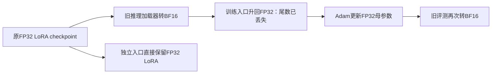

# 连续无收益：源码追踪与定向诊断

2026-10-17，针对用户“连续负提升异常，深入代码挖掘原因”的要求。未开启新的训练，所有本轮诊断均为0 optimizer更新；旧实验、checkpoint、预测、阈值和结果原样保留。新工件在`outputs/vlm_failure_code_review_v1`。下面区分已确认行为、局部因果证据与尚未证明的全局原因，不预设一定有某个致命bug。

## 1. 已确认一条有损加载路径

`vlm_object_train.train.load_actor`调用`vlm_precision.evaluate.load_path(...,'original_bf16',...)`。后者通过`autocast_adapter_dtype=False`并显式`.to(torch.bfloat16)`将LoRA一起降精度；训练加载器随后`.float()`只恢复dtype宽度，不能恢复已经舍入的值。Final评测再次使用这条全BF16路径。该行为在旧协议中明确声明，不能据此宣布旧同口径比较无效；但把推理加载器当作训练加载器，丢失原FP32母参数，是需要独立处理的代码设计问题。

源位置：`src/vlm_precision/evaluate.py:74`、`src/vlm_object_train/train.py:271`、`src/vlm_sft_resolution/experiment.py:111`附近。

真实标量示例：原SFT checkpoint第0层q_proj LoRA-A的flat index11329为`0.03356888145208359`，先转BF16再转FP32后为`0.033447265625`，绝对差`0.00012161582708358765`。这来自实际权重，不是模拟数据。存储母参数FP32也不自动表示forward以FP32计算：当前旧训练外层的BF16 autocast同样需要单独声明。

**局部因果对照**：同Final checkpoint、同原batch4与输入、同FP32 LoRA计算，仅比较原FP32权重与BF16舍入后升回FP32的权重：

| qid | 原FP32权重 | 舍入后再升FP32 | 官方分 |
| --- | --- | --- | --- |
| 10282 | rwy 28 | rwby 28 | 1→0 |
| 8738 | elizabeth ii | elizabeth | 1→.6 |
| 26905 | 3 | 4 | .6→0 |

qid10282原图绿色区域确为`RWY 28`，已经打开原图核对。该例说明至少一个原本被记为“新视觉错误”的失分可由权重舍入造成，不能全部归因遗忘。

相反，qid11104的原图`RIEGELE`，初始答对、Final输出`riegle`，在原权重FP32、舍入后FP32和全BF16三条路径中均未恢复。因此精度损失不是全部新增错误的解释。

[本地图像说明：qid10282实际原图，非模型注意力或处理输入重建](LOCAL_ARTIFACTS.md)

诊断包含全部62条变化题所在的60个原batch，加8个按输入ID哈希选出的未变batch，共272QA；它是**偏向变化病例的诊断集**。FP32原权重相对舍入权重有11条回答差异、5条涨分/0条降分、总score+2.3；不能外推全dev提分。与全BF16相比，FP32原权重有10条变化、5涨1降，总score+1.8；后一个比较同时改变权重表示与LoRA计算精度，不能都归因舍入。

同原全BF16设置重跑272QA，回答与旧保存结果0差异，说明该局部控制可以复现原数值路径。

## 2. 不是“没有更新”或“所有更新被抹掉”

两个Final的144个Adam状态均step2062。高分辨率组1843200个参数中1843195个FP32值变化，转BF16后仍有1705596个变化。有效矩阵`2*(BA_final−BA_initial)`的Frobenius范数：FP32为.422453868，转BF16后.422527721；舍入误差相对更新范数2.065%。低分辨率组有效更新范数.351991497，舍入相对误差2.508%。

因此“没有训练、优化器引用失效、BF16把更新整体清零”不符合保存权重证据。小参数误差仍可翻转临界生成答案，上述范数不证明输出等价。

## 3. 固定样本不支持简单归因过拟合

按输入ID哈希固定128条train_all与128条内部dev，同一图像预算1024，实际训练初始权重与两份Final，在BF16 AMP下计算同一assistant-only/per-QA CE：

| 模型 | 固定128训练QA CE | 固定128验证QA CE |
| --- | ---: | ---: |
| 初始SFT | .166096 | .158599 |
| low256 Final | .162852 | .152226 |
| high1024 Final | .164742 | .150917 |

验证CE也降低，不能把本轮直接解释为“训练好、验证坏”的过拟合。样本128只是诊断，不能证明所有数据上都无过拟合、已收敛或达到容量上限。

更直接的解释是**参考序列似然与greedy任务准确率之间存在缺口**：high1024在该128题中有78题NLL下降，这78题生成答案全部未变；全128题有126题答案未变。CE可以提高已有答案的置信度，或提高正确序列概率却尚未改变greedy选择，不能拿loss下降充当能力提分。

其中初始未满分的19题有12题NLL改善，这19题的生成答案全部未变；它们贡献了该128题总NLL净降低量的约88.7%。因此不能简单称为“只在正确题上增加信心”：错误题的参考序列似然也提高了，但尚未改变实际生成。teacher forcing与自生成前缀、相邻候选决策边界的具体作用仍需在训练数据上另做针对性研究，不能预先认定某个超参数或RL名称必然解决。

完整1617题中，high1024有62题回答变化，22题涨分、20题降分；获得12.8总score、丢失12.9，净−.1，恰对应−.006184pp。它不是全局灾难性退化。`RWY→RWBY`和`RIEGELE→RIEGLE`是原图可支持的具体拼写错误；`Mjöd`的不同转写、答案范围扩展则不能自动按视觉能力退化解释。完整47/62条变化题分别保存于`CASES.json`，不只展示成功案例。

## 4. 自定义损失的发现与未解决边界

`vlm_deep.common.encode/answer_labels`在prefix完全匹配后将prompt置−100；`answer_loss`只裁剪LM head输入的答案尾部，因果移位仍为`logits[:-1]`对`labels[1:]`；每QA按实际assistant token数归一，梯度累计按实际QA数归一，最后9题没有丢弃。

真实模型上裁剪与完整logits的逐题CE一致，没有发现该检查中标签错位或漏掉首答案token。BF16下反向梯度相对差1.32%；另取一易一难训练题，重复相同裁剪路径梯度0差，而裁剪/完整路径差1.456%，更换FP32输出头后仍差1.549%。因此“输出头低精度是唯一原因”的解释未成立，也不能宣称严格梯度等价。该数值/计算形状敏感尚未被证明会导致本轮质量下降，暂不将其当作统一根因，更不继续无限数值审查。

## 5. 为什么前几轮目标没有形成足够的新能力信号

- 当前继续SFT复用已训练过的32985QA和同一raw-modal目标，峰值lr5e-6是原训练1e-4的1/20。这是代码事实；是否lr过小、数据已学完没有受控证据，不能直接加lr/epoch补救。本轮固定训练样本CE边际改善约.8%，没有证明学到了新错误机制。
- `vlm_object_train.loss.normalized_qa_loss`把Object与replay各按自己的QA数平均，再用λ相加。8→32回放并未使回放项相对权重自动乘4，主要改变覆盖和估计。旧梯度诊断也显示某固定中点KL/Object梯度范数比2.699，不能以KL数值小为由断言保持梯度不够。
- 固定初始模型的KL是保持目标，不提供新的真值。回放/更新收缩等候选大多围绕“如何少忘”，主要新增任务仍很窄，不能期待仅靠保持损失产生新的识字能力。
- 公开DPO使用长描述局部纠错，Text任务为短答；既有439对诊断中325对相对margin改善，80对同时chosen绝对logp下降。偏好优化目标有变化不等于需要的任务能力提高。后续若研究DPO，需要同域、可靠的短答对照，不能重用噪声长描述池并期待换loss名称自然提分。
- 部分`completed_negative`其实有局部Object提升，如wide32 +2.047pp，但Text保持与切片门槛未过。不能把“未通过全部预设要求”误称为所有指标都负向，也不能据局部收益宣称总体能力目标已达成。

前期研究安排的缺口，是连续研究保持约束和预算变化，却没有先量化它们能否触及现有错误与生成决策边界。后续应先证明任务匹配的新增纠错信号有效，再选择SFT/DPO/在线RL，不继续叠工程审查或无依据扫超参。

这些分支共享初始SFT42、验证集和相近目标，失败高度相关；本轮两种继续训练有34条完全相同的新回答。不能把连续未达标当成独立失败事件并据此断定一个统一训练bug，但也不能把相近保持变体重复算作不同能力路线。

## 6. 独立精度修正入口与验证范围

新增`src/vlm_fp32_adapter/model.py`：明确区分BF16底座与FP32 LoRA，直接从checkpoint恢复原FP32母参数，避免先舍入再升精度；用于新协议的基线和候选，不替换冻结历史加载器。

真实Final checkpoint的144张量/1843200参数CPU回归已逐元素核验精确恢复。新入口实际GPU加载/生成检查也已通过：全部144因子与原FP32 checkpoint逐元素相同，底座BF16、LoRA FP32，实际batch4复现原FP32诊断，qid10282输出`rwy 28`。对应`FP32_LOADER_GPU_CHECK.json`。训练模式新版本尚未做backward或训练，不能冒充新训练验证或整体提分。

**全量数值对照已完成**：每条件完整1617QA/1024图、原顺序/batch4/1024视觉预算/greedy32，同样的既有checkpoint，0新训练。底座始终原BF16；新口径保留FP32 LoRA且不启用全局autocast。起点使用实际训练的BF16舍入后升FP32母参数，终点使用实际Final FP32母参数，不凭空更换训练初始化。

| 评测路径 | 实际训练起点 | 同一训练Final | 训练前后Δ pp | 配对图像簇95%区间pp |
| --- | ---: | ---: | ---: | --- |
| 原全BF16 |87.111936|87.105751|−.006184|[−.567772,+.543890]（引用原区间）|
| BF16底座＋FP32 LoRA |86.982066|87.371676|+.389610|[−.207830,+.971904]|

同一Final只改数值路径：+**.265925pp**，95%区间[−.012195,+.574934]；同一起点只改计算路径：−.129870pp，95%区间[−.444330,+.161692]。数值路径与训练前后效应的交互点值+.395795pp，95%区间[−.024908,+.860371]。因此精度确实能解释具体失分并影响全量点值，但全量区间仍跨0，不能宣称总体显著改善或解释所有历史失败。

新Final相比原先更强的全BF16起点87.111936仅+.259740pp；匹配新口径训练收益+.389610pp也未达+.5，区间下界未>0。**原实验仍未达标，不能把换数值口径回写成原候选通过；这不是新增训练或正式能力成果。** 新匹配比较为61条回答变化、28题涨分/16题降分，完整对照保存在`FULL_PRECISION_EFFECT.json`。内部dev已反复探索，该数值诊断不是独立盲测/三seed或通用能力证据。

后续验证：同日第二轮[分因诊断](VLM_FAILURE_FACTORS_V2_RESULTS.md)已用此入口完成三臂各32步真实训练QA正控制，lr1e-4的fit CE .165610→.008352、fit共识84.0625→100，probe仍93.75。该入口的训练模式已得到局部反向/更新/生成验证；这是v2的新诊断更新，不计入本文v1的零更新范围，也不构成新的泛化成果。

参考：[PEFT官方dtype说明](https://huggingface.co/docs/peft/en/developer_guides/troubleshooting#dtype-related-issues)说明adapter可独立于底座保持FP32。本文结论以本地PEFT0.15.2、Transformers4.51.1及实际控制结果为准，不把最新文档代替本地实现证据。

## 7. 后续算法行动的因果依据

先固定训练初始值、母参数存储与forward计算精度，并为基线与候选使用同一口径；单独修正精度不能冒充新训练贡献。旧SFT预算、Object回放、KL及坐标收缩负候选不继续扩参找最好dev。

若完整同口径评测仍未建立能力增益，下一个有依据的算法问题是：**在当前模型真实错误的短答任务上，可靠的on-policy正负序列监督，是否比同数据继续SFT更能改变错误生成决策？** 偏好只能来自train侧预测/可靠人工参考，验证集错误用于解释，不回填训练。去除仅同义/范围/格式差异的模糊偏好，不复用原长描述噪声池。

必要对照是同数据、同起点的chosen-SFT、标准DPO、DPO+chosen-NLL。最后一项直接对应既有80/325个margin改善却chosen绝对概率下降的现象：在相对排序项之外提供绝对正确答案似然监督；它不保证每道chosen概率都上升，也不声称为原创方法。只有明确数据、尺度与训练侧有效纠错证据后才登记正式预算，不现在按dev扫γ/β/lr。

当前未启动上述新训练。GRPO/PPO也不能跳过奖励有效性：原10000题四采样中7483组奖励恒定，属于已有信号风险而非GRPO已失败。换算法名称不能替代同域监督、有效组内比较与独立生成评测。

## 工件

`CPU_WEIGHTS.json`、`FIT.json`、`LOSS_VS_DECODE.json`、`PRECISION.json`、`GRADIENT_MATH.json`、`CASES.json`、`FP32_LOADER_REGRESSION.json`均位于[诊断目录](LOCAL_ARTIFACTS.md)。完整同口径评测另存`full_fp32_initial/`与`full_fp32_high1024/`；不覆盖原`vlm_sft_resolution_v1`结果。
