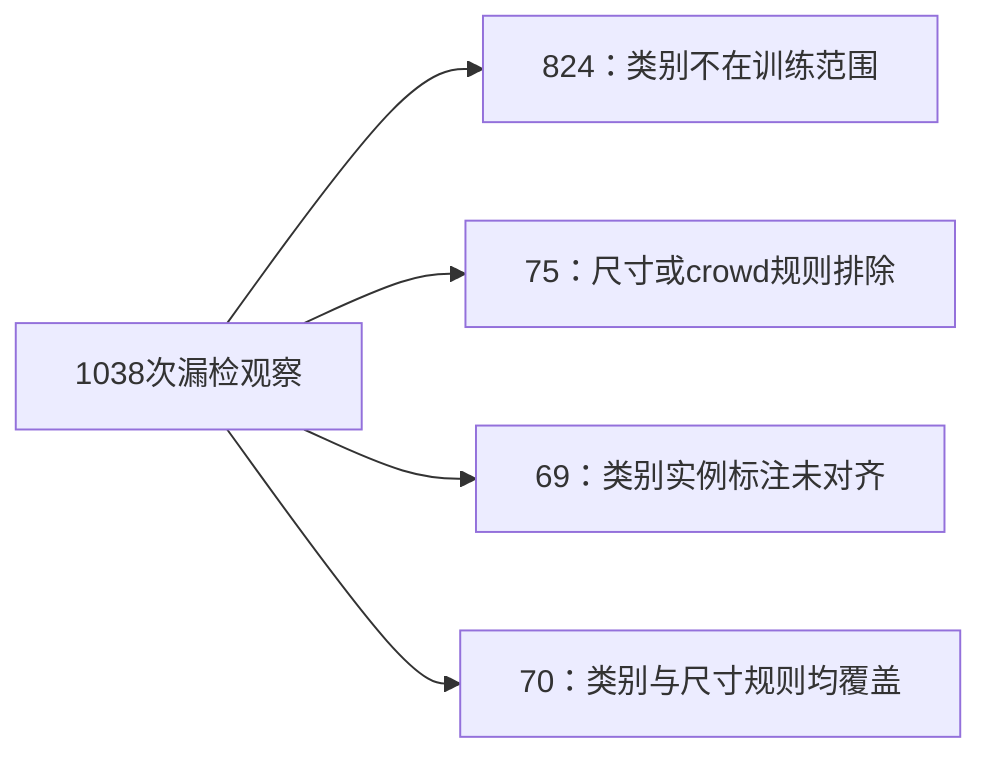

# 失败原因分解：第二轮数据与优化诊断

2026-10-17，针对用户要求区分数据、算法、框架与训练设置。上一轮精度/mask/权重/reference检查直接引用，不重复全量审查。新统计与短程正控制在`outputs/vlm_failure_factor_review_v2`，[事前协议](VLM_FAILURE_FACTORS_V2.md)保持不变。

## 已确认的数据覆盖问题

当前Object训练不是全COCO：公开RLHF-V图片池内1211图/2888QA，限定18类动物/交通工具；正例1444QA，仅2题的合格实例全部为COCO small。14个small实例与2447个medium/large实例是实例数，不是QA数，不能混计。此前为了降低标注歧义采用了保守过滤，内部任务明确性提高，但主要错误覆盖不足。

对已有完整POPE9000的初始模型预测按类别/尺寸重新做描述性分组，**不重评分、不改标签、不新生成**：

| 正标签分组 | 正QA观察 | 漏检观察 | 组内漏检率 |
| --- | ---: | ---: | ---: |
| 训练18类之外 |3753|824|21.96%|
| 在18类内且满足正例尺寸规则 |501|70|13.97%|
| 在18类内但尺寸/crowd规则会排除 |150|75|50.00%|
| 对应类别缺少实例标注对齐 |96|69|71.88%|

总1038次漏检中，**79.38%**来自类别范围之外，另**7.23%**会被尺寸/crowd规则排除。符合当前直接正监督范围的只有70次；这不是提升上限或因果贡献比例，因为跨类迁移仍可能发生。不能说“86.6%的训练失败由数据导致”。

POPE三种策略重复正图问，不把9000QA当独立样本。按唯一正图像×对象组合也一致：范围外1251组/任一次漏检277组；合格167组/任一次漏检24组；尺寸排除50组/漏检25组；缺实例对齐32组/漏检23组。全部500张图ID均能在COCO2017找到，问题不是图片ID整体丢失。

代码直接来自`src/vlm_object_presence_v2/data.py`：`CATEGORIES`限定18类；`qualifies`要求同一noncrowd实例短边≥24、segmentation area/image area≥.005。范围和过滤均是我们数据构造的选择，不是HF框架限制。

## 标签语义口径冲突，不是本地错位

本地Object负例规则为`category_ids - annotated_any_including_crowd_category_ids`：实例标注缺少该类就可作为no候选。POPE官方说明其对象收集参考分割标注和captions，两种真值定义不能自动视为一致。[固定版本官方说明](https://github.com/AoiDragon/POPE/blob/08d957b917e5a378a2f99d35b6293c536a66298b/README.md#collect-ground-truth-objects)。

重新下载同一固定commit的官方adversarial文件，全部3000条与本地原文件完全一致；以下不是我们转换标签或评测对齐产生的错误：

| COCO图ID | 原图观察 | POPE正问题 | 实例标注 |
| --- | --- | --- | --- |
|190185|热狗三明治，无动物狗可见|dog=yes|bowl、sandwich|
|381895|毛绒熊|bear=yes|person、teddy bear|
|574057|列车卧铺内景|train=yes，car=yes|bed|
|332625|飞机客舱内景|airplane=yes|chair、person、tv|

这说明构词/语义边界、玩具与真实实体、场景推断与实例存在存在差异；不能把69次缺标对齐全部叫错标，也不能把它们全部叫模型视觉失败。原图已直接打开核对。对于列车/飞机内景，场景推断可以成立但没有整车实例框；`dog`与热狗则暴露明显的词义歧义风险。

[本地图像说明：dog正问题对应的实际原图](LOCAL_ARTIFACTS.md)

官方评测口径仍保留，不为了消除失分修改标签/分母；这些已暴露评测图不回填训练，未来需要按业务/任务定义在train侧统一语义与正负样本规则，并以独立评测检验，不能针对这500图补数据刷分。

## TextVQA：覆盖不足与响应类型混合，不能泛称全是脏标签

32985训练QA中，监督目标字符串未覆盖的内部dev QA为687/1617，初始得分84.032；其缺失score109.7，占全部缺失score的52.64%。rare1–5贡献20.68%，frequent>20贡献21.45%，mid贡献5.23%。这是下游实际target的文本频率，不是视觉类/概念频率，更不是模型预训练未见。

因此，仅按已见答案频次加权并不能直接补足开放词汇监督或稀有识字组合；也不能从评测答案反向扩充训练字典。需要训练侧的可核验识字/grounding纠错与组合泛化监督。

众数target的人类共识较高是既有事实，不能据此宣称每个target视觉上都正确。训练中有503条unanswerable、499条“answering does not require reading text in image”目标；后者来自原始标注checkbox，[原论文补充材料](https://openaccess.thecvf.com/content_CVPR_2019/supplemental/Singh_Towards_VQA_Models_CVPR_2019_supplemental.pdf)明确给出这种反馈。它们体现响应类型混合，不自动等于1002条错标；不直接删除或以之解释全部失败。

## 算法目标与实现：目前能确认什么

- SFT CE与greedy准确率之间的缺口已有实测：固定128QA里78题参考NLL下降而答案不变，其中12题原本未满分。它表明当前更新未改变这些错误决策，不能单凭这个现象认定CE算法本身无效。
- 自蒸馏KL提供保持而非新真值。Object/replay各自归一后再按λ相加，增加replay数量不是自动增大相对约束权重。不能继续把保持项变体当作新能力的主要来源。
- DPO实现是标准序列SUM、固定reference、sigmoid形式。既有偏好长描述与短答评测不匹配，噪声诊断也未满足质量门槛；margin变好且chosen绝对概率降低的现象不说明DPO符号写反，也不证明DPO/PPO/GRPO方法族无效。
- 已确认的精度损失来自我们的加载策略，而不是已证实的HF库bug。原始SFT/检索已有真实提升、当前参数/Adam确实更新，不支持“框架整体不能学习”。新加载器的实际训练能力与设置影响由本轮正控制补证。

## 短程学习正控制的解释范围

真实32QA拟合、32个图像不重叠训练域probe，三臂固定32更新；只比较全局autocast与学习率。无验证/正式集选题，无新模型架构。三臂已完整结束，同一个raw FP32初始张量SHA、同一初始得分与数据顺序核验一致。

| 计算/设置 | 初始fit CE | Final fit CE | CE降低 | fit共识分：前→后 | probe共识分：前→后 |
| --- | ---: | ---: | ---: | --- | --- |
| BF16全局autocast，lr5e-6 |.165610|.139140|15.98%|84.0625→82.1875|93.75→93.75|
| 关闭autocast，lr5e-6 |.165610|.138664|16.27%|84.0625→82.1875|93.75→93.75|
| 关闭autocast，lr1e-4 |.165610|.008352|94.96%|84.0625→100.0000|93.75→93.75|

两个小LR臂均未通过事前学习正控制，高LR臂通过。因果解释范围：

1. 相同真实数据/模型下，高LR可以把监督标签拟合到100%，说明修正后的本地加载、forward、loss、backward、Adam与生成链路能实际学习；不支持“底层框架整体不能训练”的解释。这比只检查梯度非零更有判别力，但不等于排除所有框架细节或证明视觉推理。
2. 两个小LR臂的CE和生成结果接近，关闭全局AMP没有解决该局部弱优化；不能继续把训练无收益主要归到AMP一个因素。
3. 后两臂只变LR20倍，结果支持小LR在此32步/constant-LR局部诊断中约束了拟合速度。它不是原2062步warmup/decay的完整复刻，不能直接推出全量最佳LR。
4. 高LR没有提高probe得分，probe CE反而从.063538升到.069783；小样本点值不证明普遍退化，但明确没有新的泛化证据。不能将32QA的100分写为模型能力提升或简历成果，也不能不修数据就用大LR重训全部任务。

本轮共96次诊断更新、1536次fit QA曝光，仅32条不同fit QA；probe另32条且曾参与原SFT。没有丢弃的工程优化步，学习适配器单独归档，不自动替换项目主模型。

即使高LR更易拟合，也不能直接把1e-4当作全量最佳LR；即使三臂均能拟合，也不能排除所有框架细节。此控制用于排除学习链路完全失效、定位局部优化强弱，不作为真实能力提分或新项目成果。

## 分因结论与下一优先级

| 因素 | 证据状态 | 结论 |
| --- | --- | --- |
| 数据覆盖/任务定义 | 已确认明显不匹配 | Object/POPE分支最需先修复；不能以更高内部18类分数替代主要漏检覆盖。Text开放答案目标频率不足与DPO长描述偏好不匹配分别处理，不混成一个“脏数据率”。 |
| 算法配方/目标 | 已确认目标与任务收益有缺口 | SFT似然、DPO相对margin、KL保持不自动等于目标能力。标准算法公式未发现符号级错误，方法族无效未被证明。 |
| 框架/实现 | 正控制支持链路可学；已发现过加载精度问题 | 自定义有损加载策略需修正，HF/PyTorch整体失效没有证据。不优先重建/切换整个框架。 |
| 训练设置 | 局部控制支持小LR拟合偏弱 | 建立更新强度合理的强SFT对照，但全量LR/epoch、容量与视觉主干冻结的因果作用仍未隔离。 |
| 评价语义/泛化 | 官方标签含边界，当前probe无增益 | 官方分数照报，语义案例单列；真正能力提升仍须独立任务与种子复核。 |

这个排序是证据与行动优先级，不是各因素造成失败的百分比分摊。Object、Text继续SFT、公共DPO不是同一训练问题，不能把18类覆盖缺口解释成所有TextVQA失败的唯一原因。

后续顺序：先在train侧按明确任务语义补足类别/难度覆盖，尤其不要把“缺实例框”直接视为语义确定不存在；保留质量与覆盖的平衡，不根据已暴露POPE错题回填训练。然后在同一数值口径下建立足够强的SFT基线；只有仍有生成决策问题时，再比较可靠同域偏好优化的额外价值。新大规模训练尚未启动，旧门槛/旧负结果不改。

## 数据工件

[数据与覆盖统计](LOCAL_ARTIFACTS.md) · [POPE类别/尺寸分组](LOCAL_ARTIFACTS.md) · [官方标签逐条对照](LOCAL_ARTIFACTS.md) · [32组语义边界案例](LOCAL_ARTIFACTS.md) · [事前短程计划](LOCAL_ARTIFACTS.md)

[三臂完整结果](LOCAL_ARTIFACTS.md) · [分因汇总](LOCAL_ARTIFACTS.md)
