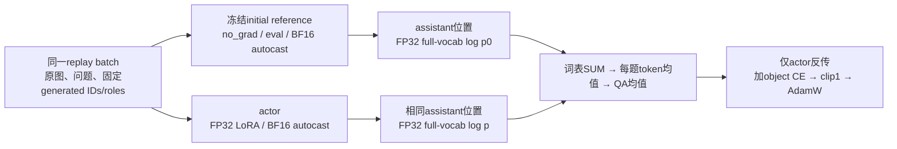

# 固定生成前缀的全分布 KL：独立实验协议 v1

设计登记：2026-10-16。本文件先于新 GPU 实验建立；实现、CPU 合同和来源锁通过前不运行训练。旧协议、源码、权重、预测和验收记录均不修改。

## 研究问题与已有证据

上一轮 `vlm_object_behavior_replay_v1` 已完成两臂各181更新和3918条新评分预测，独立评分零差异。唯一候选 teacher CE32 的 Object 准确率95.614→97.661（+2.047pp，单侧98.75%下界+0.552pp），TextVQA87.112→87.062（−0.049pp，下界−0.423pp），整体非劣性通过。rare−0.117pp、frequent−0.240pp点保护失败，6/8门槛通过；原候选不晋级。

rare 的净差来自一题 `spring→spring water`、共识分1→0.6；frequent来自一题 `0→channel10`、1→0，后者两臂同错。这些是事后诊断，不能据此断言普遍视觉退化，不能用这两题的图像、问题、答案或得分构造训练补丁。所有dev参考只在生成后评分、既定切片和学习展示中使用。

本轮假设：在相同固定teacher生成前缀上，保留初始模型的完整条件分布，可能比继续锐化单一硬目标更好地保持回答与停止行为。假设尚未得到验证；旧wide32是GT前缀上的全分布KL，不是GT硬CE，因此本轮有明确的新条件。跨历史实验不得宣称完整、无混杂的2×2因果消融。

## 唯一候选、参照及变量

- 唯一可晋级候选为 `teacher_kl32`。初始SFT42和上一轮teacher CE32为不可变参照；不重训已完成CE，不让GT控制替补候选。
- seed42逐题复用已验收的5792条实际teacher生成ID、原顺序、角色与模板边界，及2888条对象训练QA、181更新计划。回放前缀不decode后重新tokenize，不过滤、重采样或按答案正确性选题。复用训练输入必须声明父协议及原格式标签，不把旧 `teacher_ce32` 输入格式标签冒充新损失身份。
- 只将回放训练目标由hard CE改为固定初始模型的forward KL。对象CE、初始参数、QA/顺序、输入、可训练位置/数量、181次更新、学习率与优化器设置保持。新增参考前向和显存另计，不宣称等FLOPs、等时间、推理加速或新压缩方法。
- 本轮属于固定生成前缀上的离线自蒸馏/功能正则化；没有学生在线采样、奖励、偏好对、RLHF、DPO或GRPO。

## 目标函数

每次更新对象集O为16题（最后8题），回放集R为32题，微批4题。每题只在既定assistant位置集合A上汇总；提示位置仍为−100。对象和回放分别按QA独立求均值：

\[
L=\frac1{|O|}\sum_{i\in O}\frac1{|A_i|}\sum_{t\in A_i}-\log p_\theta(y_{it}\mid x_i,y_{i,<t})
+\frac1{|R|}\sum_{j\in R}\frac1{|A_j|}\sum_{t\in A_j}\sum_{v\in V}p_0(v\mid x_j,\hat y_{j,<t})[\log p_0(v\mid x_j,\hat y_{j,<t})-\log p_\theta(v\mid x_j,\hat y_{j,<t})].
\]

固定λ=1、T=1。词表求和、每题有效token平均、再按QA平均；禁止默认词表平均、整batch token平均、top-k/其他质量桶近似或hard CE混入回放优化。保留FP32 full-vocab log-softmax/概率计算。回放hard CE只可用同一次actor logits作不反传的诊断，必须与KL分列。

first-content、later-content、actual-EOS、template-suffix互斥且保持原token权重。实际chat EOS151645后原有198保留；其他EOS和截断规则按父输入合同，不发明新token。包括EOS/template的KL与内容KL均记录，诊断不改变损失。

### 从梯度理解这一个变化

对单一位置的logits，hard CE的梯度为`p_actor − onehot(teacher实际生成token)`；固定参考forward KL的梯度为`p_actor − p_reference`，再按既定token/QA均值缩放。教学例子：若三个词的概率都是`[0.7, 0.2, 0.1]`、硬目标为第一个词，CE梯度为`[-0.3, 0.2, 0.1]`，同分布KL梯度为`[0, 0, 0]`。这是原理演示，不是本轮实测logits。

父轮真实初始hard-CE预检记录为replay CE约0.101327、回放梯度范数约0.523954；本轮的KL与梯度必须从实际预检填入，不能把理论零填作结果。

稀疏的是assistant预测位置，词表仍为完整151936项。位置数量依据实际微批记录，不能将整段prompt误纳入KL或把最后一个prompt位置与第一个答案预测位置错开。

## 模型与数值路径

actor为原BF16冻结基座/视觉模块、144个语言q/v LoRA FP32 master张量，共1843200可训练参数；BF16 autocast、非重入checkpoint、dropout0、AdamW、lr5e−6、warmup0.1、wd0、共同clip1、Final@1epoch。常规每25更新保存完整恢复状态，Final固定，不按dev选checkpoint。

reference是独立载入的同一初始模型，BF16基座和FP32 LoRA，使用同BF16 autocast计算训练条件分布，所有参数requires_grad=False、无optimizer和梯度。reference固定eval、关闭gradient checkpointing、在no_grad中前向；actor保持原train/非重入checkpoint。两者具有相同参数与数值策略，autograd/checkpoint执行路径不同，不声称逐bit同图；是否足够接近由实际初始KL检查决定。actor/ref参数storage不得共享，初始LoRA canonical SHA均为`6a44359406c53261b254c3a19393c63187b34af09baec539d6b235ca148c0fa7`。完整参数/冻结状态在预检和训练完成后验证；构建reference前后恢复actor RNG。reference只接收同一实际replay batch，禁止参考答案或额外OCR进入生成评测。

已生成前缀来自父轮原生BF16/no-autocast解码；本轮新增soft reference是actor训练算术路径。这两种角色明确分列，不假称完全相同的推理路径。reference只在线前向，不新增15.685GiB概率bank，不读取或重建旧GT-prefix概率bank。模型参数、buffers、RNG与实际内存均记录。

## 必须通过的工程检查

1. CPU检查真实父产物接口、父锁/验收SHA、完整181计划和8680条既定输入引用；复用已通过的teacher/输入/Final验收，不重复旧流语义审计或历史全预测评分。相关纯函数及新增有效源码显式纳入新锁，冻结旧源码保持原字节。
2. 实际GPU准入后先运行新目标的嵌入式预检，再允许正式更新。初始reference/actor最大每QA绝对KL≤1e−5，有限原始值保留；初始replay梯度范数≤对象梯度范数的1%，对象梯度有限正。该数值容差不等于性能门槛，不得根据dev或预检失败静默放宽。若前向模式造成偏差，保留失败并在新版本声明修正，不以理论同权重代替实测。
3. 一次临时Adam更新后验证actor确有变化、reference精确不变、KL及其恢复梯度有限正；保存实际值而非只写理论零。临时更新不进入正式181，恢复actor/优化器边界、buffers、RNG后哈希精确回到初始。额外探针/前向逐项记账。
4. reference不推进随机路径；optimizer仅含actor144个FP32张量。每源QA归一化、assistant移位和所有目标位置逐项核对。65GiB峰值上限，超出或合同不符就保留失败证据退出，不自动改batch、精度、量化或mask。
5. 首步与Final保存实际输入/角色及数值检查；完整训练完成后一次独立验收全部8680条实际合同、181更新与Final/Adam/RNG。中途正常checkpoint不逐个重复审计。恢复只从完整更新边界并校验全部来源，不重排已有队列/worker身份。

## 评测及完整成功范围

原生BF16/1024视觉token上限、batch4、greedy32、SDPA、关闭TF32，不截断。每格8题评测预检单列；seed42只新增一个候选的342 Object及1617 Text正式预测，共1959 model×QA。初始与已完成CE参照用显式不可变引用，不重新生成。计分器、图像配对和切片合同保持。

单seed候选必须同时通过原八项：Object点增益≥1pp、其单侧98.75%下界>0；Text整体差值下界>−0.5pp；Object recall点不降、specificity点差≥−0.5pp；固定逐类yes/no均衡子集点差>0；Text rare与frequent点差均≥0。点保护不证明切片非劣或群体改善，失败不删除或放宽。

只有全部通过，才执行seed0/200的新5792条固定teacher前缀、同一初始SFT42上的数据顺序/回放抽样重复与完整181更新。三seed先按题平均再按图像簇bootstrap，均值±样本SD另列；均值满足原八项且每seed对象增益为正、Text点差≥−0.5pp。

三seed内部通过后才执行三seed完整4372题外部集及原3438题均衡子集：均值accuracy≥+0.5pp、单侧下界>0、每seed正收益，F1/recall点不降、specificity点差≥−0.5pp、均衡点差>0。通过后才执行三seed完整9000题POPE（500共享图像、三类别各3000），相同accuracy/F1/recall/specificity保护和三类别点不降，以及既定Text保护。

四主端点为内部Object、Text非劣、external Object和POPE accuracy，α=.05/4=.0125，6000次图像整簇配对bootstrap、seed20261015、单侧98.75%下界。沿用原全部门槛，不把单seed、pilot或工程检查当完整目标完成。所有阶段通过并完成root独立来源、模型、输入、评分、案例与成本验收后，才可能确认完整真实提升。

## 资源、报告与学习

共享队列每卡可用≥40GiB、利用率<10%、零compute任务，3次15秒观察及UUID锁；动态独立准入、同role同UUID恢复。不得终止已有任务或为占满显卡重跑已完成对照。两模型单卡方案以实际65GiB预检为准。

报告区分参考前向、actor训练、额外工程探针、正式评测、CPU来源校验、排队和完整壁钟；显存allocated/reserved分列。新代码/配置/参考模型/父输入均显式绑定，新输出目录独立。内部dev已反复探索、公开预训练重叠未知、历史对照不是新增独立重复，均保留限制。

学习继续使用原图→实际token/角色→代码/张量→保存预测/评分。数学演示中`p−onehot`与`p−p0`必须标为原理；初始KL/梯度和显存用实际预检值，不把理论值冒充实测。新学习产物在本轮输出目录保存，父轮已验收学习页保持原字节。简历不自动修改。

## 方法来源与边界

完整条件分布蒸馏及生成前缀分布问题参考[GKD原论文](https://arxiv.org/abs/2306.13649)；本轮没有学生在线采样，不是on-policy GKD复现。曾评估[A-GEM](https://arxiv.org/abs/1812.00420)和[PCGrad官方代码](https://github.com/tianheyu927/PCGrad)，但当前CE正式日志无分源梯度冲突或实际Adam更新证据，因此不添加投影机制。上述文献不证明本候选必然改善本项目，原全部性能门槛保持。
