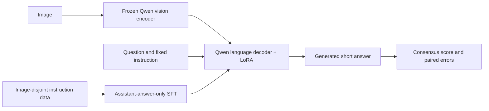

# Generative VLM adaptation: Qwen-VL → QLoRA SFT → generated-answer evaluation

Added under the user's explicit 2026-10-09 instruction to extend the project with recurring recruitment requirements and keep one resume. The original CLIP algorithms/results retain their frozen protocols; this module has a separate model, dataset, supervision and metrics.

The fixed pilot is complete. Actual training, paired generation, resource measurements and limitations are in [VLM_SFT_RESULTS.md](VLM_SFT_RESULTS.md).

## Executable route and scope



The task includes scene text and visual reasoning in TextVQA. It connects CV inputs with autoregressive language outputs. It is a small training/engineering pilot, not a complete OCR system, video model, new algorithm or full TextVQA benchmark. Model pretraining exposure to TextVQA is not audited; the baseline is an existing instruction-tuned model, not a model trained from scratch.

## Pre-execution settings

Settings were written before any generated-answer evaluation in [config](../configs/vlm_sft_textvqa.json). Qwen2.5-VL-3B-Instruct is pinned to official HF revision `66285546d2b821cf421d4f5eb2576359d3770cd3`; Qwen's ModelScope mirror supplies the identical weight hashes and records exact file/config hashes. Dataset revision: `9c0699cd19768ac5ab97568f6b3cbac4c0062884` of `lmms-lab-encoder/textvqa`.

The source pool is the first two pinned training Parquet shards and the first official-validation shard. Select one question/image using a fixed hash order, split training-pool images into **1,024 train / 128 internal validation**, and use **256 official-validation images** for final evaluation. Reject overlap by image ID and decoded pixel hash; validate ten human answers, question content, image decoding and source hashes. This selection is a limited source pool, not a representative full-dataset sample. OCR annotation tokens are not supplied to the model.

**Pre-evaluation transport revision:** repeated Parquet download timeouts and a rejected hash mismatch led to the public Dataset Viewer fallback. Its pool is the first 4,000 official-train question rows and first 1,000 official-validation question rows, with the same 1,024/128/256 selected image counts. Every returned image URL must include the pinned dataset revision; raw annotation responses and downloaded images are hashed. The executed report states which transport produced the manifest. This change occurs before model scoring, not in response to outcomes.

Six candidate rows have all ten normalized human answers empty. Exclude these before image grouping/hash selection and retain their source-row/question IDs and reasons in manifest provenance. This is an annotation usability filter, not a model-score filter; the selected image counts stay 1,024/128/256.

Images are obtained from the pinned viewer CDN or the public Open Images original by the annotation's image ID. The source transport, downloaded-byte hash, decoded-pixel hash and final PNG hash are recorded per image. This image-download fallback is established before final model scoring; both compared runs use the same locally locked images.

Only q/v attention projections in the language decoder receive rank-8 LoRA (alpha16, dropout.05). Vision encoder, connector and base language weights remain frozen. Train one fixed epoch at lr1e-4 with AdamW, weight decay0, warmup4, microbatch1, accumulation4 and four DDP workers, effective batch16. The initial attempt used FP16 with GradScaler and FP32 LoRA optimizer parameters; the executed numerical repair is specified below. Vision budget64–256 visual tokens, maximum sequence768. SDPA is used because V100 does not provide the recommended FlashAttention2/BF16 path. Actual CUDA, PyTorch and parameter/resource counts are recorded by the run.

**Numerical compatibility revision:** the FP16 attempt encountered a nonfinite supervised forward loss at step24/64, before producing an adapted checkpoint or adapted final score. The executed configuration therefore uses NF4 4-bit language linear weights with double quantization and FP32 compute (QLoRA); the vision encoder and nonquantized layers remain FP32. The pretrained baseline is rerun with precisely the same quantization/precision. The earlier FP16 baseline and failed training logs are archived separately and excluded from paired results. Data, rank, learning rate, epoch count, effective batch and generation settings are unchanged. This is a numerical repair, not a score-selected hyperparameter search. Frozen-weight hashes cover packed weights and their quantization states.

The first DDP training launch was terminated with SIGKILL during concurrent model initialization; the container has about 32 GiB host RAM despite a much larger physical host. Implementation repair: place weights directly on each local GPU and initialize ranks serially, then train with the same four-worker DDP configuration. It changes initialization memory scheduling, not weights, data, loss or training budget. Failed logs remain archived; no adapted final scores existed at the repair point.

Construct the complete multimodal chat template, check it starts with the generation prompt token sequence, then mask the entire prefix with `-100`. Loss supervises assistant answer and closing tokens only. No silent image-token truncation. Internal validation answer-token NLL is diagnostic; select the final fixed epoch rather than test-selected hyperparameters/checkpoints. Frozen base parameter values are hashed before/after training.

## Evaluation and efficiency

Use identical image/question prompt, pixels and greedy generation (`max_new_tokens=32`) for pretrained and LoRA models. Generation messages accept no reference-answer input. Only after generation does the scorer read ten human answers.

Metric: leave-one-annotator-out VQA consensus formula, with explicitly declared compact normalization (case, whitespace, punctuation, articles and numbers0–10). This implementation does not reproduce the entire official evaluator's contraction dictionary; call it a normalized consensus pilot score, not the full official benchmark score. Also report normalized any-answer matching as a secondary diagnostic, complete paired improved/degraded/unchanged counts, and a 2,000-resample conditional image bootstrap interval. One training seed and a limited image pool do not establish generalization.

Record generation p50/p95, output tokens per generation second, four-worker end-to-end image throughput, and per-device peak allocated/reserved GPU memory. Exclude each worker's first generation from timing summaries but retain it in accuracy. These measurements describe the executed configuration; no unmeasured serving acceleration is claimed. The inference CLI is local deployment capability, not an online production service.

Short-answer formatting and generated output length also affect score and latency. A change in normalized consensus score is not by itself proof of improved OCR perception, and differing generation times are not an equal-output-length kernel acceleration comparison.

## Reproduce

Use the optional environment dependencies. All large generated files are ignored by Git.

```bash
pip install -r requirements-vlm.txt
python -m vlm_sft.assets --output-root artifacts/vlm_sft --model
python -m vlm_sft.prepare_viewer --asset-root artifacts/vlm_sft
python -m vlm_sft.pipeline --asset-root artifacts/vlm_sft \
  --run-root artifacts/vlm_sft/runs --public-output results/vlm_sft_metrics.json
```

The pipeline runs four workers using `torch.distributed.run`, preserves stage logs/status, and stops on errors. Actual model/data metadata and the run's input lock are stored alongside artifacts. Do not overwrite a prepared manifest to change sample selection after seeing scores.

```bash
python -m vlm_sft.infer --model-dir artifacts/vlm_sft/model \
  --adapter-dir artifacts/vlm_sft/runs/train/adapter \
  --image /path/to/image.jpg --question "What brand is visible?"
```

Assets are external: follow the downloaded Qwen model license and official TextVQA/image terms. The release distributes code and compact metrics, not model weights, dataset images or adapter weights.

Sources: [Qwen model card](https://huggingface.co/Qwen/Qwen2.5-VL-3B-Instruct), [versioned Transformers model API](https://huggingface.co/docs/transformers/v4.51.3/en/model_doc/qwen2_5_vl), [PEFT LoRA API](https://huggingface.co/docs/peft/v0.15.0/en/package_reference/lora), [TextVQA release](https://textvqa.org/dataset/), [job-to-route evidence](JOB_ROUTE.md). One unified resume is in [RESUME.md](RESUME.md).

Quantization implementation: [versioned bitsandbytes integration](https://huggingface.co/docs/transformers/v4.51.3/en/quantization/bitsandbytes). QLoRA is a standard parameter-efficient technique; no new fine-tuning algorithm is claimed.
