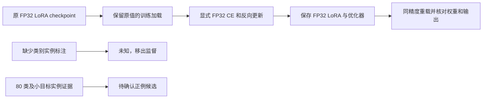

# 失败问题修复与验证（2026-10-17）

本轮处理已定位的实现和标签构造问题；历史实验、官方评测标签及原有提升门槛保持。没有将诊断拟合或保存成功当成模型能力提升。

## 修复内容

| 问题 | 原行为 | 新行为与代码 |
| --- | --- | --- |
| LoRA 精度丢失 | FP32 checkpoint → BF16 → FP32，尾数无法恢复 | [加载器](../src/vlm_fp32_adapter/model.py)从 checkpoint 恢复原 FP32 母参数；[新训练入口](../src/vlm_fp32_adapter/train.py)在训练、保存、重载中实际使用它 |
| 无 AMP 时的 CE 精度 | 旧 helper 没有显式转为 FP32，依赖 AMP 的提升规则 | [新损失](../src/vlm_fp32_adapter/loss.py)明确执行 `output.logits.float()`，保留可微梯度和逐 QA 归一化；底座/输出头仍为 BF16 |
| 标注缺失被当成否定 | 缺少某类别实例标注就生成 `target=no` | [v3 数据转换](../src/vlm_object_presence_v3/data.py)将这些记录改为 `target=None`、`presence=None`、`unknown`，不能用于 CE/DPO/奖励标签 |
| 类别和困难样本覆盖 | v2 只保留 18 类和较大清晰目标 | v3 候选保留原 80 类及小目标，不据模型预测或评测答案选择；候选尚需语义确认 |
| 完成状态滞后 | 历史进度文件结束后仍可能显示 evaluating | 新训练入口完成时同步写 `PROGRESS.json` 与 `COMPLETE.json`；不改历史状态或实验源码 |

旧 BF16 协议仍是原协议下的有效结果。新精度入口不能与旧缓存基线直接拼成算法增益；新基线和候选必须共享加载、计算、生成和评分条件。旧全局 AMP 训练中的 CE 不一定存在此精度问题；显式 FP32 CE 是消除调用环境依赖，尚无证据说明它单独导致旧负结果。

## 原理与实际数值

训练损失为每个问题的 assistant token 平均负对数似然，再在更新批次中按 QA 平均：

\[
L=\frac1B\sum_{i=1}^{B}\frac1{T_i}\sum_{t=1}^{T_i}-\log p_\theta(y_{it}\mid x_i,y_{i,<t}).
\]

`logits.float()` 让 softmax/CE 和汇总使用 FP32，不会恢复此前已经舍入的权重。权重保真必须在加载时另外解决。已确认的真实参数例子为 `0.03356888145208359 → 0.033447265625`；之后再 `.float()` 只能保留后一个值。此前同 FP32 计算对照中，舍入可使真实答案 `rwy 28` 变成 `rwby 28`，但该案例不代表整体准确率提升。



## 真实数据处理结果

| 划分 | 图像 | 正例候选 | 正例类别 | 仅小目标候选 QA | 原负例改为未知 |
| --- | ---: | ---: | ---: | ---: | ---: |
| train | 3,211 | 9,576 | 80 | 2,047 | 9,576 |
| val | 423 | 1,280 | 79 | 294 | 1,280 |

来源：`outputs/vlm_object_presence_v3/SUMMARY.json`。所有数量均来自已有真实图像和 COCO 实例记录；小目标数是 QA 数，不是实例数。v1/v2 共 128 张已审查训练图被排除；继承原 train/val、图像/pixel/file/COCO ID 边界及 POPE 排除表，没有把 benchmark 图像或答案加入训练。

这修正了错误的监督假设，**尚未解决可靠负例的获取和所有正例的可见语义质量**。新数据输出为 `*_CANDIDATES.json`，所有记录 `supervision_eligible=false`，整体 `training_allowed=false`；它不是仅含 yes 的可训练数据。缺乏框/图注不能证明 no；不能用模型自己回答 no 就当真值，也不能把“hot dog”机械映射为动物 dog。

## 验证与运行

针对性回归测试：[test_training_repairs_v3.py](../tests/test_training_repairs_v3.py)，3 项通过。覆盖无 AMP 的 FP32 CE/梯度与显式参考一致、错误的 assistant tail 布局拒绝、未知负例不进入监督及 18 类外小目标保留。

真实模型集成使用 [固定配置](../configs/vlm_training_repairs_v3.json)：Qwen2.5-VL-3B，BF16 底座/FP32 LoRA、无全局 AMP、FP32 CE、1024 视觉预算、1,843,200 个可训练参数；按固定 hash 选择 8 条不同训练图 QA、一次遍历 2 个更新。4 条训练 QA 仅用于保存重载一致性验证，不是独立任务评测，也不是新性能实验。

集成状态：**已完成并通过**（北京时间 2026-10-17 14:15）。真实 A100 上 8 QA/2 更新均完成，训练 CE 为 FP32、梯度范数分别为 1.4251 和 3.4449；第一次更新保存后实际调用恢复优化器/权重断点，再完成下一次更新。最终 144 个 FP32 LoRA 张量的完整哈希与重载后一致，4 QA 的 CE 和生成文本逐项完全一致。训练循环实测 5.62 秒（含本轮循环内 IO；不含模型加载、重载和生成核验），不作为全量训练 ETA。最终 `PROGRESS.json`/`COMPLETE.json` 及资源队列均为 completed，无资源竞争记录、未停止其他任务。原始结果在 `outputs/vlm_training_repairs_v3/COMPLETE.json`。

新训练入口（先加载持久环境并设置 `PYTHONPATH=src`）：

```bash
python -m vlm_fp32_adapter.train --config configs/vlm_training_repairs_v3.json
```

默认经现有共享 GPU 门控；8 QA 配置仅供实现验证，不部署产物。完整研究需要另定可信数据、合理强 SFT 对照及同数值条件的初始/最终独立评测。当前不重跑相同低 LR 全量配方，不凭 32 QA 拟合结果直接把全量 LR 调大，不启动 DPO/GRPO 来绕过错误监督。

下一项科学工作应补齐**图像依据明确的同域 yes/no 监督与场景语义定义**，然后训练一个共享模型并验证独立任务得分。未获得该能力证据前，不增加新的简历提分声明。
